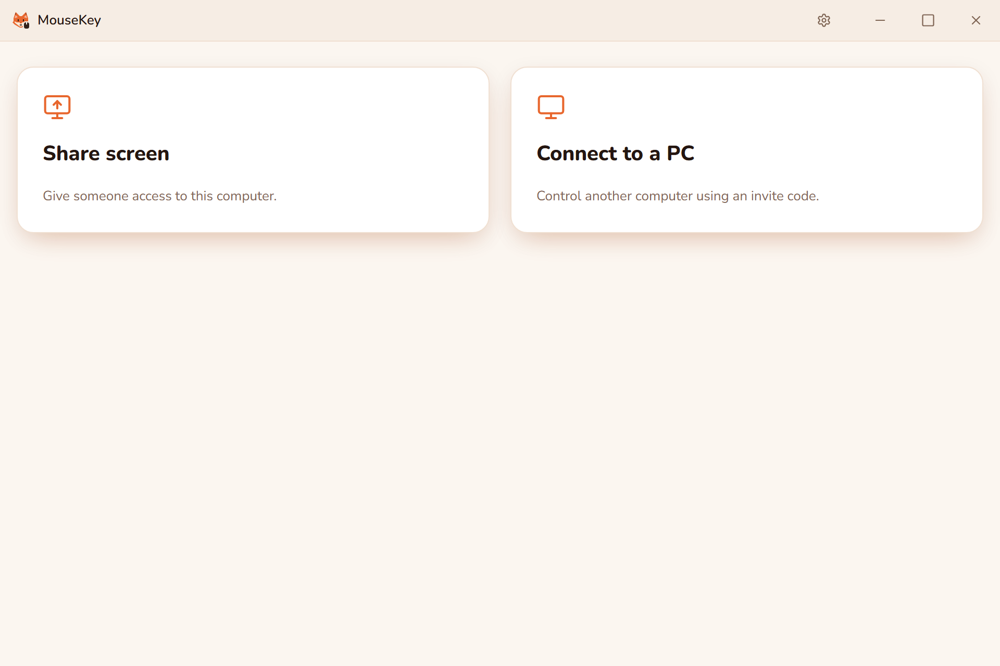
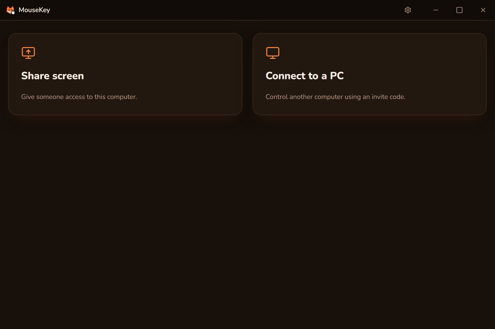
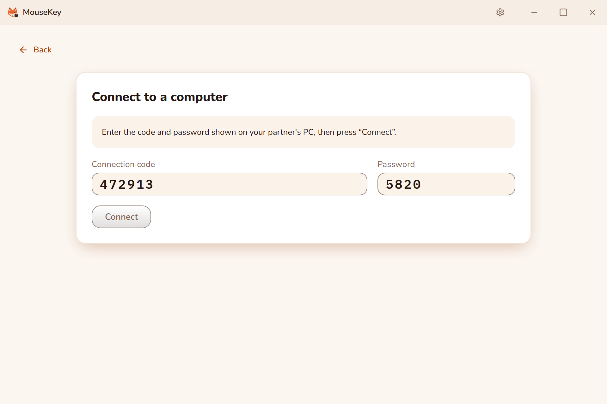
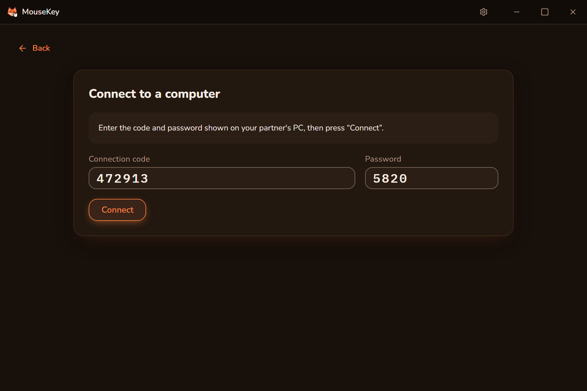
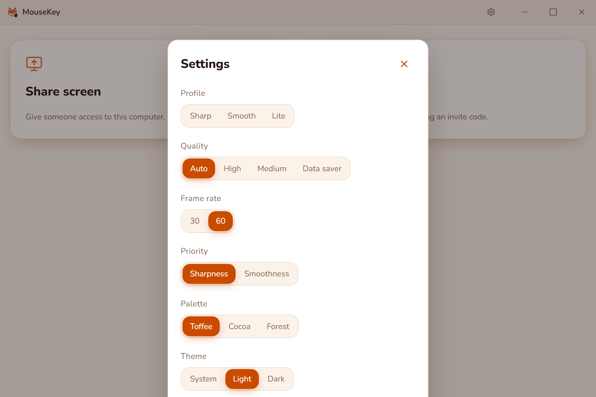
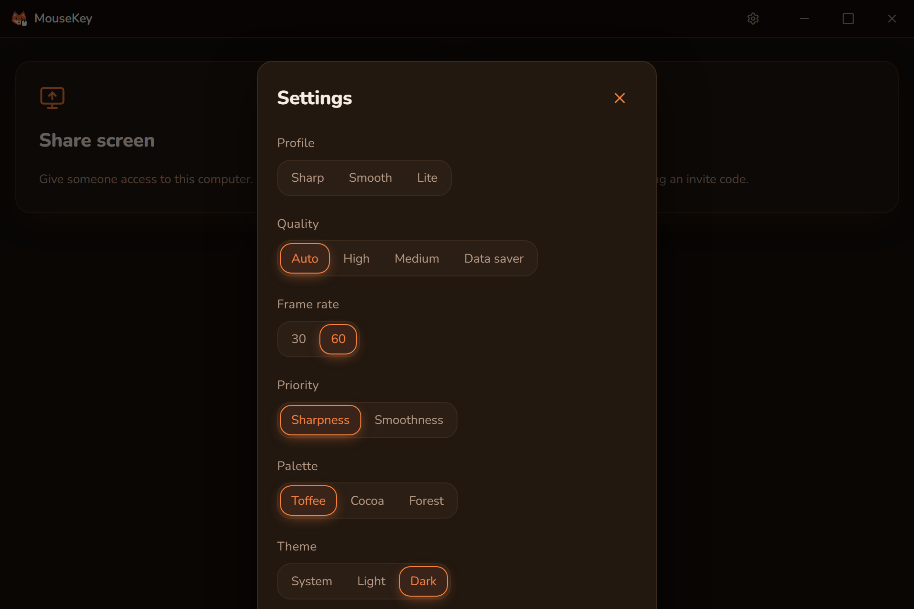
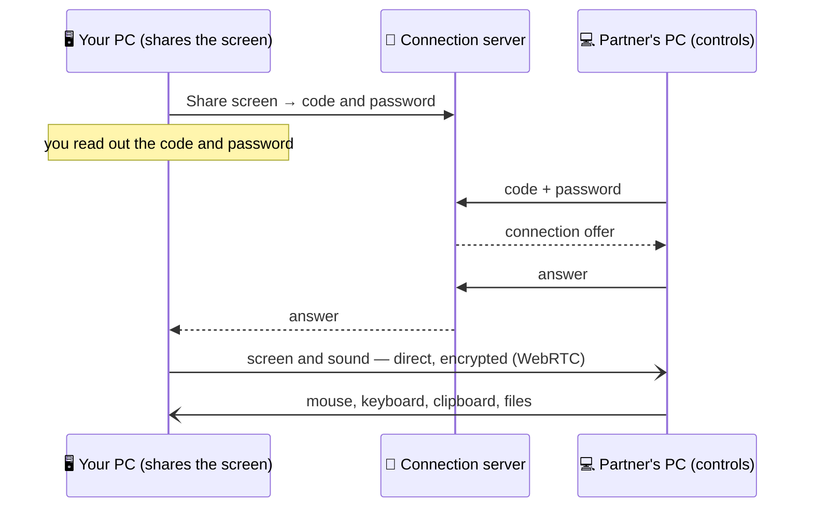

<div align="center">


<br>

**Another computer's screen, mouse and keyboard — with a short code and a password.**

MouseKey connects two PCs directly: one shares its screen, the other controls it. Persistent access and accounts to sync your computers;
a light app built with Rust and Tauri 2.

<br>

[](https://github.com/DiFoxenGit/MouseKey/releases/latest)


[**⬇️ Download**](#️-download) ·
[**🖼 Screenshots**](#-screenshots) ·
[**🚀 Install**](#-install) ·
[**🛡 Privacy and security**](#-privacy-and-security) ·
[**Русский**](README.md)

</div>

---

## 📑 Contents

- [What it is](#-what-it-is)
- [Screenshots](#-screenshots)
- [How it works](#️-how-it-works)
- [System requirements](#-system-requirements)
- [Download](#️-download)
- [Install](#-install)
- [Privacy and security](#-privacy-and-security)
- [FAQ](#-faq)
- [License](#-license)

---

## 🎯 What it is

MouseKey is remote access to your own computers and a way to help family and friends — like AnyDesk or RustDesk, but
small and our own. One person presses **Share screen** and reads out a code and a password; the other enters them and
sees the first person's screen.

| | |
|---|---|
| 🔑 **Code and password** | Windows hosts keep a nine-digit number and password; temporary legacy codes are also supported |
| ⚡ **Direct P2P** | Video and input go straight between the computers (WebRTC); if the network blocks that, through a relay |
| 🖱 **Mouse and keyboard** | Hover over the image to control without a preliminary click; leaving releases held input |
| 📋 **Clipboard and files** | A shared clipboard in both directions and file transfer during a session |
| 🖥 **Change screen** | Pick a screen or a window; Fit, 1:1, Stretch and full screen |
| 🎚 **Quality** | Sharp, Smooth and Lite profiles, quality and 30 or 60 frames per second |
| ⏸ **Pause remote control** | The partner still sees the screen, but their mouse and keyboard do not reach it; held keys are released |
| 🦊 **Tray** | Session state, End session, Pause remote control; the tray never opens access without asking |
| 🔌 **ESP32 board** | Optional: mouse and keyboard input through a board that acts as a regular USB device |
| 🧩 **Scenarios (Windows)** | ESP keys/clicks, window focus, precise image comparisons, template search and click, OCR text variables, loops and variables, timing ranges, curved paths, connected visual blocks, saved layouts and clock scheduling; [guide](docs/scenarios.md) |
| 🗔 **Multiple instances** | Launch the app again for separate settings, scenarios and ESP connections in each instance |
| 👤 **My computers** | Accounts sync cards, validate credentials on add, show availability and connect explicitly |
| 🪟 **Windows and startup** | Screen-only windows, live snapping, numeric dimensions and opt-in automatic sharing |
| 🎨 **Fox Brand** | Toffee, Cocoa and Forest palettes, light and dark themes; English and Russian |
| 🔄 **Auto-update** | Updates are signed with the project key and checked before they install |

## 🖼 Screenshots

The new look is the shared DiFoxen brand, **Fox Brand**: the app mark is the fox with a mouse, Toffee palette.

<table>
<tr>
<td width="50%"></td>
<td width="50%"></td>
</tr>
<tr>
<td align="center"><b>Home</b><br><sub>light theme</sub></td>
<td align="center"><b>Home</b><br><sub>dark theme</sub></td>
</tr>
<tr>
<td width="50%"></td>
<td width="50%"></td>
</tr>
<tr>
<td align="center"><b>Connect with a code and password</b><br><sub>light theme</sub></td>
<td align="center"><b>Connect with a code and password</b><br><sub>dark theme</sub></td>
</tr>
<tr>
<td width="50%"></td>
<td width="50%"></td>
</tr>
<tr>
<td align="center"><b>Settings</b><br><sub>light theme</sub></td>
<td align="center"><b>Settings</b><br><sub>dark theme</sub></td>
</tr>
</table>


## ⚙️ How it works



- **The server only introduces the computers.** It passes the offer and the answer for a code and never sees the
  screen, the input or the files.
- **Then it is direct.** The computers connect to each other; if the network does not allow a direct connection, the
  stream goes through a relay and stays encrypted.
- **Input is part of the app.** A Rust component types the mouse and keyboard input on the controlled PC; when the
  session ends or something fails, every held key is released.

## 💻 System requirements

| | |
|---|---|
| **System** | Windows 10 or 11, 64-bit |
| **Component** | Microsoft Edge WebView2 — already in Windows 11; on Windows 10 the installer sets it up |
| **Network** | Internet on both PCs: the connection server finds the partner by code |
| **ESP32 board** | Not needed — only for input through a board |

For Linux (X11), use [release 0.3.2](https://github.com/DiFoxenGit/MouseKey/releases/tag/v0.3.2). The 0.6.0 scenarios execute on Windows.

## ⬇️ Download

The latest version is on the [**Releases**](https://github.com/DiFoxenGit/MouseKey/releases/latest) page.

| File | What for |
|---|---|
| `MouseKey_<version>_x64-setup.exe` | **The installer for most people** — installs for the current user and updates itself |
| `MouseKey_<version>_x64_en-US.msi` | MSI installer — for deployment in organisations |
| `*.sig`, `latest.json` | Signatures and the update feed — the app reads them itself |
| `SHA256SUMS.txt` | Checksums of every file in the release |

<details>
<summary><b>How to check a downloaded file</b></summary>

<br>

In PowerShell:

```powershell
Get-FileHash .\MouseKey_0.18.0_x64-setup.exe -Algorithm SHA256
```

The hash must match the file's line in `SHA256SUMS.txt` of the same release.

</details>

## 🚀 Install

1. Download `MouseKey_<version>_x64-setup.exe` from the [releases](https://github.com/DiFoxenGit/MouseKey/releases/latest) page.
2. Run the installer and follow the steps.
3. On the PC that will be controlled, press **Share screen**, pick a screen and read out the code and password.
4. On the other PC, press **Connect to a PC**, enter the code and password, then **Connect**.

> [!NOTE]
> The installer is not yet signed with a certificate authority certificate, so Windows SmartScreen shows a warning:
> More info → Run anyway. Updates are signed with the project key: the app checks the signature and will not install
> a file it did not sign.

> [!IMPORTANT]
> **If you have MouseKey 0.3.0**, update to 0.3.1 once by hand: download the installer and run it over the installed
> copy. 0.3.0 had a private update address; from 0.3.1 updates come from here and install on their own.

## 🛡 Privacy and security

- **Accounts sync computer cards.** Registration uses a username and password without email or phone. The server stores password hashes, hashed session tokens and grants to saved computers.
- **You enable sharing.** Manual sharing uses the screen picker. Automatic sharing is off by default and must be enabled explicitly; it starts with the first application instance.
- **Persistent access can be revoked.** Administrator changes to a number or password invalidate saved grants. Computer passwords are not stored in accounts. Windows host secrets use Windows Credential Manager.
- **The connection server does not see the session.** It only passes the offer and the answer and does not store
  them; the screen, sound, input, clipboard and files go between the computers directly or through a relay — either
  way inside WebRTC encryption (DTLS-SRTP).
- **Pause and end take effect at once.** Pause remote control stops the partner's input, End session closes the
  connection; if the app crashes, the session closes too and held keys are released.
- **Crash details without extras.** Copy details on the crash screen removes the user name from paths and the
  parameters from addresses; nothing is sent anywhere automatically.
- **Signed updates.** The app installs an update only with the project key's signature.

Found a vulnerability? Report it privately — see [SECURITY.md](SECURITY.md).

## ❓ FAQ

<details>
<summary><b>Is the source code here?</b></summary>

<br>

No. This is a showcase: releases with installers, the changelog and feedback. MouseKey's code is closed.

</details>

<details>
<summary><b>The connection does not start</b></summary>

<br>

Check connectivity on both PCs and that the host is sharing. A red indicator means the computer is offline or busy. Add the card again after a password change. Legacy six-digit temporary codes expire after 10 minutes.

</details>

<details>
<summary><b>Can I control a PC when nobody is at it?</b></summary>

<br>

Yes. Enable startup and automatic desktop sharing on the Windows host. Automatic sharing runs in instance #1, captures the primary monitor at up to 720p/12 fps without audio. See [persistent access](docs/access.md).

</details>

## 📝 Changes

What is new in each version — [CHANGELOG.md](CHANGELOG.md) and the [release](https://github.com/DiFoxenGit/MouseKey/releases) notes.

## 📄 License

MouseKey is proprietary freeware, all rights reserved: you may download and use it, but not redistribute it modified
or take it apart — see [LICENSE](LICENSE). Open-source components inside the app and their licenses —
[THIRD_PARTY_NOTICES.md](THIRD_PARTY_NOTICES.md).

<div align="center"><br><sub>© 2026 DiFoxen · MouseKey — your own remote access · <a href="README.md">Русский</a></sub></div>

### MouseKey 0.13.1

Saved blocks below the canvas; auxiliary controls stay collapsed.


### MouseKey 0.14.0

Collapse blocks to icons while keeping their connections and expanded dimensions.


### MouseKey 0.15.0

Collapse all and Expand all control the entire diagram. Resize handles no longer cover connection ports.


### MouseKey 0.15.1

Arrange uses visible block dimensions and packs collapsed icon squares closer together.


### MouseKey 0.16.0

Accounts and computer cards, persistent access and hover control.


### MouseKey 0.17.0

Revocable temporary access keys, side-by-side connection panels, automatic sharing recovery, a visible cursor and maximization that preserves the app header.

### MouseKey 0.18.0

Adaptive quality for multiple connections, collapsible diagnostics, faster automatic capture, a local cursor and F9 input broadcasting. Update both PCs for adaptation; ESP firmware stays compatible.
