<div align="center">

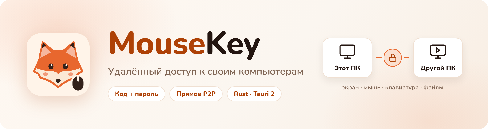

<br>

**Экран, мышь и клавиатура другого компьютера — по короткому коду и паролю.**

MouseKey соединяет два ПК напрямую: один показывает экран, другой управляет им. С постоянным доступом и аккаунтами для синхронизации компьютеров;
лёгкое приложение на Rust и Tauri 2.

<br>

[](https://github.com/DiFoxenGit/MouseKey/releases/latest)


[**⬇️ Скачать**](#️-скачать) ·
[**🖼 Как выглядит**](#-как-выглядит) ·
[**🚀 Установка**](#-установка) ·
[**🛡 Приватность и безопасность**](#-приватность-и-безопасность) ·
[**English**](README.en.md)

</div>

---

## 📑 Содержание

- [Что это](#-что-это)
- [Как выглядит](#-как-выглядит)
- [Как устроено](#️-как-устроено)
- [Системные требования](#-системные-требования)
- [Скачать](#️-скачать)
- [Установка](#-установка)
- [Приватность и безопасность](#-приватность-и-безопасность)
- [Частые вопросы](#-частые-вопросы)
- [Лицензия](#-лицензия)

---

## 🎯 Что это

MouseKey — удалённый доступ к своим компьютерам и помощь близким: как AnyDesk или RustDesk, только своё и лёгкое.
Один человек нажимает «Поделиться экраном» и диктует код и пароль, второй вводит их у себя — и видит чужой экран.

| | |
|---|---|
| 🔑 **Код и пароль** | На Windows — постоянный девятизначный номер и пароль; временные коды прежних клиентов также поддерживаются |
| ⚡ **Прямое P2P** | Видео и ввод идут напрямую между компьютерами (WebRTC); если сеть не пускает — через ретранслятор |
| 🖱 **Мышь и клавиатура** | Управление при наведении без предварительного клика; при уходе с изображения ввод отпускается |
| 📋 **Буфер обмена и файлы** | Общий буфер обмена в обе стороны и отправка файлов во время сеанса |
| 🖥 **Смена экрана** | Выбор экрана или окна, «Вписать», «1:1», «Растянуть», полноэкранный режим |
| 🎚 **Качество** | Профили «Чётко», «Плавно», «Экономно», качество и 30 или 60 кадров/с |
| ⏸ **Пауза управления** | Партнёр видит экран, но мышь и клавиатура не доходят; нажатые клавиши отпускаются |
| 🦊 **Трей** | Состояние сеанса, «Завершить сеанс», «Приостановить управление»; доступ из трея не открывается без подтверждения |
| 🔌 **Плата ESP32** | По желанию: ввод мыши и клавиатуры через плату как через обычное USB-устройство |
| 🧩 **Сценарии (Windows)** | Клавиши и клики через ESP, фокус окна, точное сравнение картинки, поиск и клик по образцу, OCR в текстовые переменные, циклы и переменные, диапазоны задержек, плавные траектории, визуальные блоки со связями, сохранение схем и расписание; [инструкция](docs/scenarios.md) |
| 🗔 **Несколько экземпляров** | Запускайте приложение повторно: отдельные настройки, сценарии и подключения ESP в каждом экземпляре |
| 👤 **Мои компьютеры** | Аккаунт синхронизирует карточки; пароль проверяется при добавлении, доступность видна по индикатору, подключение — отдельной кнопкой |
| 🪟 **Окна и автопоказ** | Режим «Только экран в окне», притягивание при движении, точный размер; автопоказ и автозапуск включаются в настройках |
| 🎨 **Fox Brand** | Палитры Toffee, Cocoa и Forest, светлая и тёмная тема; русский и английский |
| 🔄 **Автообновление** | Обновления подписаны ключом проекта и проверяются перед установкой |

## 🖼 Как выглядит

Новый облик — общий бренд DiFoxen **Fox Brand**: знак приложения — лис с мышью, палитра Toffee.

<table>
<tr>
<td width="50%">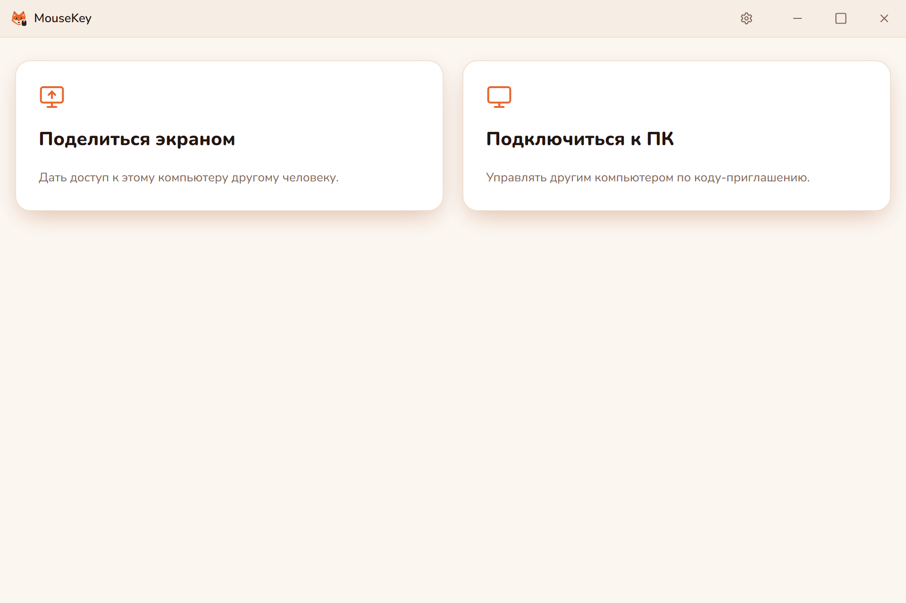</td>
<td width="50%">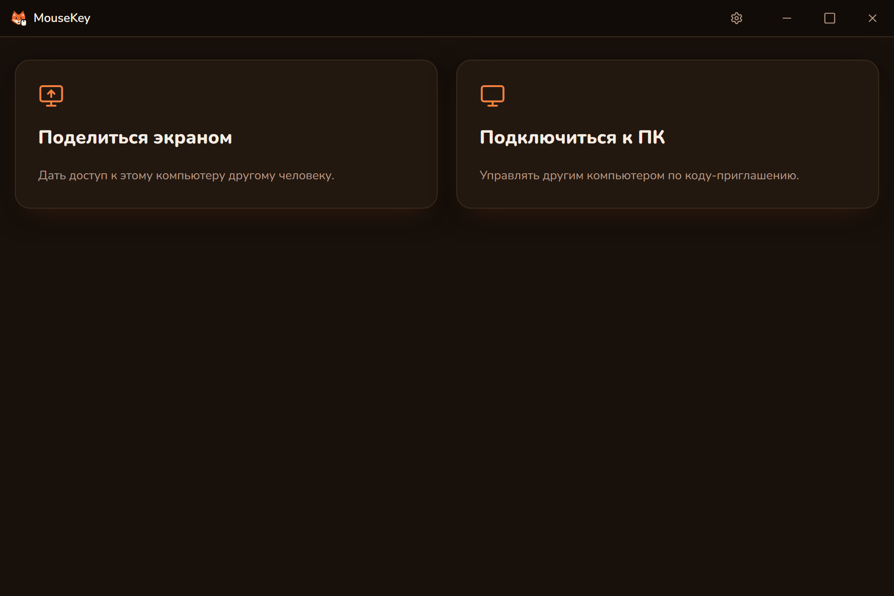</td>
</tr>
<tr>
<td align="center"><b>Главный экран</b><br><sub>светлая тема</sub></td>
<td align="center"><b>Главный экран</b><br><sub>тёмная тема</sub></td>
</tr>
<tr>
<td width="50%">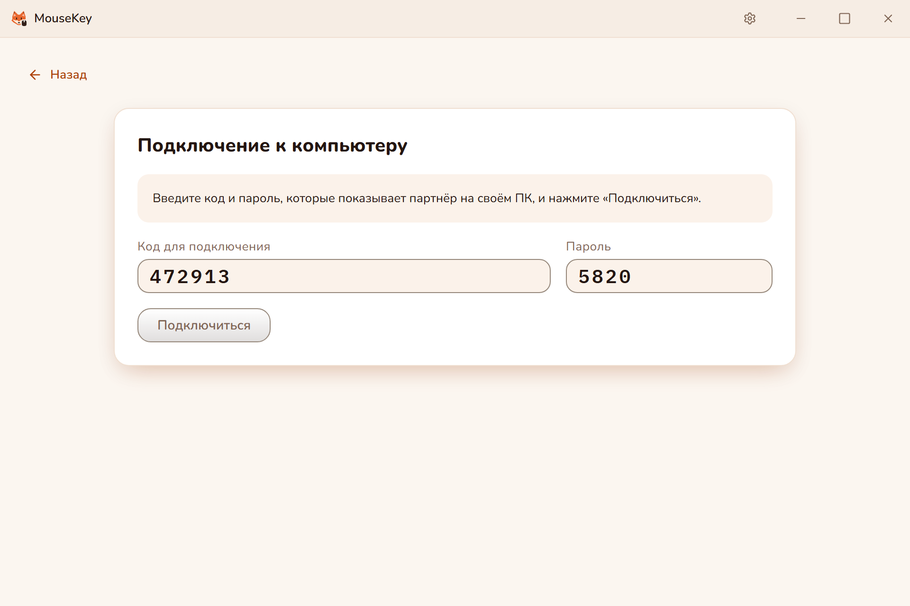</td>
<td width="50%">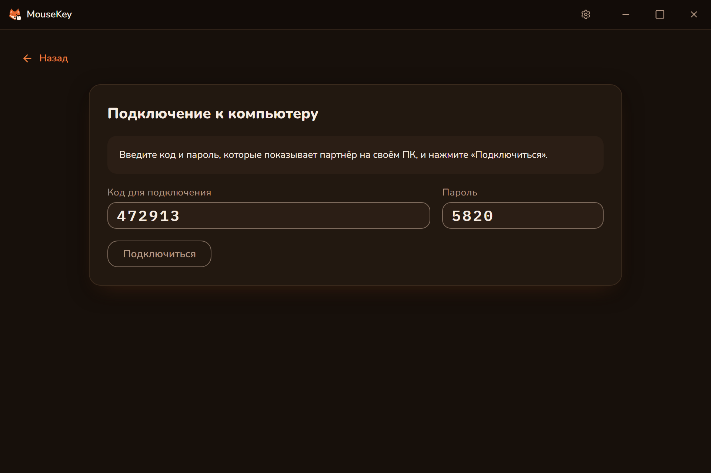</td>
</tr>
<tr>
<td align="center"><b>Подключение по коду и паролю</b><br><sub>светлая тема</sub></td>
<td align="center"><b>Подключение по коду и паролю</b><br><sub>тёмная тема</sub></td>
</tr>
<tr>
<td width="50%">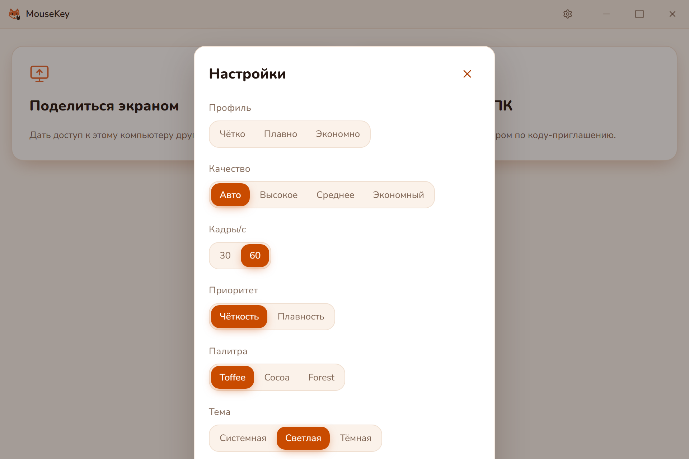</td>
<td width="50%">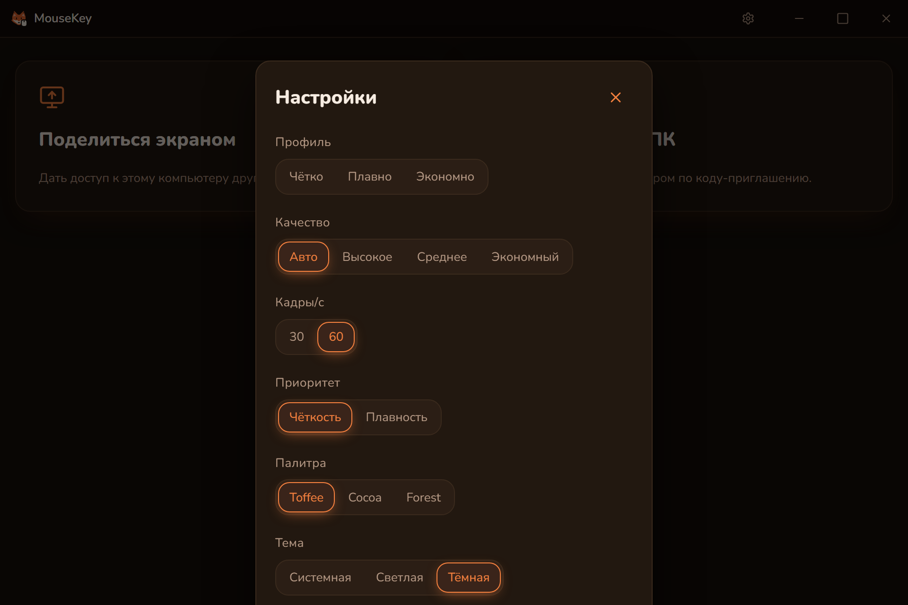</td>
</tr>
<tr>
<td align="center"><b>Настройки</b><br><sub>светлая тема</sub></td>
<td align="center"><b>Настройки</b><br><sub>тёмная тема</sub></td>
</tr>
</table>

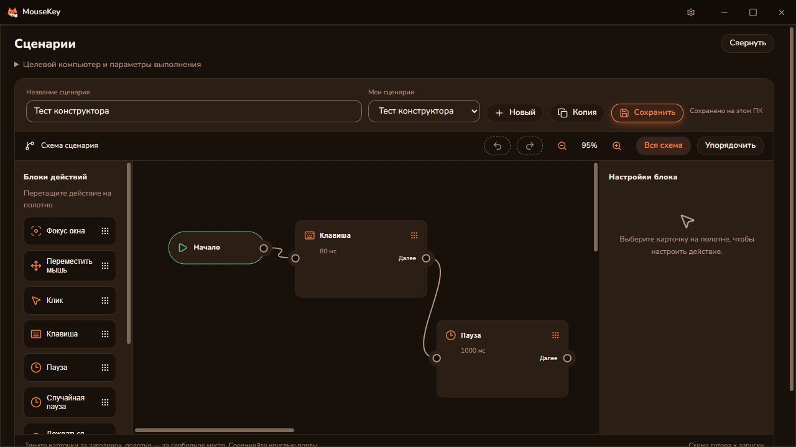

## ⚙️ Как устроено

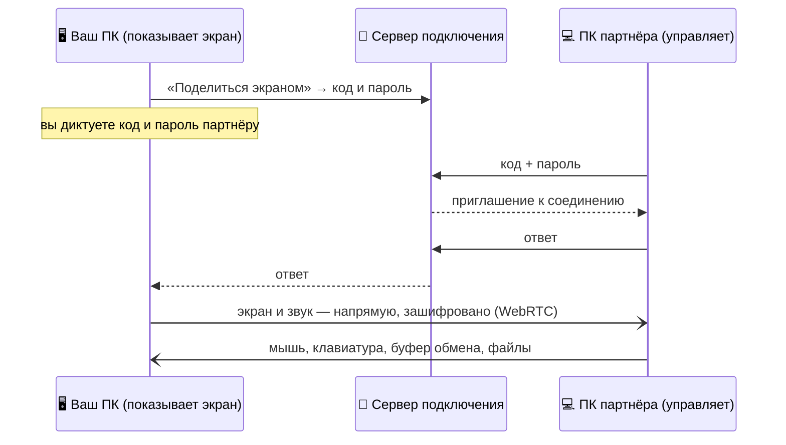

- **Сервер только сводит компьютеры.** Он передаёт приглашение и ответ по коду и не видит экран, ввод и файлы.
- **Дальше — напрямую.** Компьютеры соединяются друг с другом; если сеть не пропускает прямое соединение, поток
  идёт через ретранслятор и остаётся зашифрованным.
- **Ввод — в самом приложении.** Мышь и клавиатуру на управляемом ПК вводит часть на Rust; при ошибке или конце
  сеанса все нажатые клавиши отпускаются.

## 💻 Системные требования

| | |
|---|---|
| **Система** | Windows 10 или 11, 64-бит |
| **Компонент** | Microsoft Edge WebView2 — в Windows 11 уже есть, в Windows 10 установщик поставит его сам |
| **Сеть** | Интернет на обоих ПК: сервер подключения нужен, чтобы найти партнёра по коду |
| **Плата ESP32** | Не нужна — только для ввода через плату |

Для Linux (X11) доступен [предыдущий выпуск 0.3.2](https://github.com/DiFoxenGit/MouseKey/releases/tag/v0.3.2). Сценарии 0.6.0 выполняются на Windows.

## ⬇️ Скачать

Последняя версия — на странице [**«Выпуски»**](https://github.com/DiFoxenGit/MouseKey/releases/latest).

| Файл | Для чего |
|---|---|
| `MouseKey_<версия>_x64-setup.exe` | **Установщик для большинства** — ставит для текущего пользователя, обновляется сам |
| `MouseKey_<версия>_x64_en-US.msi` | Установщик MSI — для развёртывания в организации |
| `*.sig`, `latest.json` | Подписи и лента автообновления — их читает само приложение |
| `SHA256SUMS.txt` | Контрольные суммы всех файлов выпуска |

<details>
<summary><b>Как проверить скачанный файл</b></summary>

<br>

В PowerShell:

```powershell
Get-FileHash .\MouseKey_0.19.6_x64-setup.exe -Algorithm SHA256
```

Сумма должна совпасть со строкой этого файла в `SHA256SUMS.txt` того же выпуска.

</details>

## 🚀 Установка

1. Скачайте `MouseKey_<версия>_x64-setup.exe` со страницы [выпусков](https://github.com/DiFoxenGit/MouseKey/releases/latest).
2. Запустите установщик и следуйте шагам.
3. На ПК, к которому подключаются, нажмите **«Поделиться экраном»**, выберите экран и продиктуйте код и пароль.
4. На втором ПК нажмите **«Подключиться к ПК»**, введите код и пароль — и **«Подключиться»**.

> [!NOTE]
> Установщик пока не подписан сертификатом удостоверяющего центра, поэтому Windows SmartScreen покажет
> предупреждение: «Подробнее» → «Выполнить в любом случае». Обновления подписаны ключом проекта: приложение
> проверяет подпись и не поставит файл, который подписан не им.

> [!IMPORTANT]
> **Если у вас MouseKey 0.3.0** — обновитесь до 0.3.1 один раз вручную: скачайте установщик и запустите его поверх.
> В 0.3.0 был закрытый адрес обновлений; с 0.3.1 обновления приходят отсюда и ставятся сами.

## 🛡 Приватность и безопасность

- **Аккаунт — для списка компьютеров.** Регистрация использует логин и пароль без почты и телефона. Сервер хранит хеши паролей, токены сеансов в виде хешей и разрешения на сохранённые подключения.
- **Доступ включаете вы.** Ручной показ начинается после выбора экрана. Автопоказ выключен по умолчанию и включается отдельно в настройках; он начинает трансляцию при следующем запуске первого экземпляра приложения.
- **Постоянный доступ можно отозвать.** Смена номера или пароля администратором отзывает сохранённые разрешения. Пароли компьютеров в аккаунте не сохраняются. Секреты Windows-хоста хранятся в диспетчере учётных данных Windows.
- **Сервер подключения не видит сеанс.** Он только передаёт приглашение и ответ и не хранит их; экран, звук, ввод,
  буфер обмена и файлы идут между компьютерами напрямую или через ретранслятор — в обоих случаях в шифровании WebRTC
  (DTLS-SRTP).
- **Пауза и конец сеанса — сразу.** «Приостановить управление» перестаёт пускать ввод партнёра, «Завершить сеанс»
  закрывает соединение; при сбое приложения сеанс тоже закрывается, а нажатые клавиши отпускаются.
- **Отчёт о сбое — без лишнего.** «Скопировать сведения» на экране сбоя убирает имя пользователя из путей и параметры
  из адресов; сведения никуда не отправляются сами.
- **Обновления подписаны.** Приложение ставит обновление только с подписью ключа проекта.

Нашли уязвимость? Сообщите приватно — см. [SECURITY.md](SECURITY.md).

## ❓ Частые вопросы

<details>
<summary><b>Здесь есть исходный код?</b></summary>

<br>

Нет. Это витрина: выпуски с установщиками, список изменений и обратная связь. Код MouseKey закрыт.

</details>

<details>
<summary><b>Подключение не устанавливается</b></summary>

<br>

Проверьте интернет на обоих ПК и включённый показ на хосте. Красный индикатор означает недоступный или занятый компьютер. После смены пароля добавьте карточку заново с новым паролем. Временные шестизначные коды прежних клиентов действуют 10 минут.

</details>

<details>
<summary><b>Можно ли управлять ПК, когда за ним никого нет?</b></summary>

<br>

Да. На управляемом Windows-ПК включите автозапуск и автоматический показ рабочего стола. Автопоказ работает в первом экземпляре: основной монитор, до 1280×720 и 30 кадров/с, без звука. Подробнее — [постоянный доступ](docs/access.md).

</details>

## 📝 Изменения

Что нового в каждой версии — [CHANGELOG.md](CHANGELOG.md) и заметки к [выпускам](https://github.com/DiFoxenGit/MouseKey/releases).

## 📄 Лицензия

MouseKey — проприетарное бесплатное ПО, все права защищены: можно скачивать и пользоваться, нельзя
распространять изменённым или разбирать — см. [LICENSE](LICENSE). Открытые компоненты внутри приложения и их
лицензии — [THIRD_PARTY_NOTICES.md](THIRD_PARTY_NOTICES.md).

<div align="center"><br><sub>© 2026 DiFoxen · MouseKey — свой удалённый доступ · <a href="README.en.md">English</a></sub></div>

### MouseKey 0.13.1

Сохранённые блоки под полотном; дополнительные настройки свёрнуты.

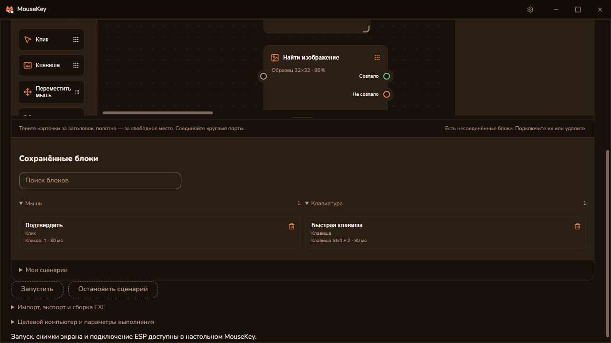

### MouseKey 0.14.0

Кнопка на блоке сворачивает его до иконки, сохраняя связи и прежний размер.

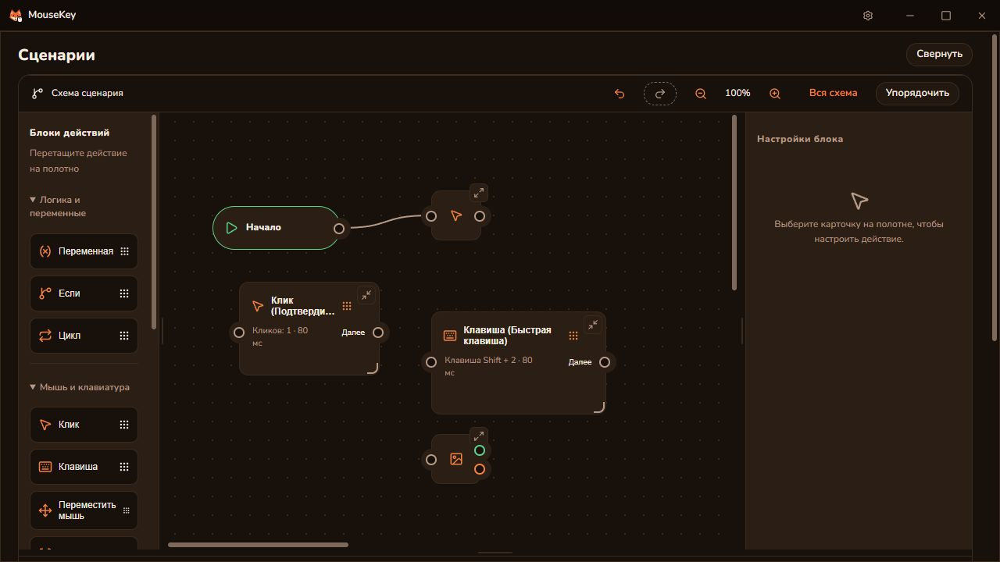

### MouseKey 0.15.0

«Свернуть все» и «Развернуть все» меняют вид всей схемы. Порты больше не перекрываются ручками размера.

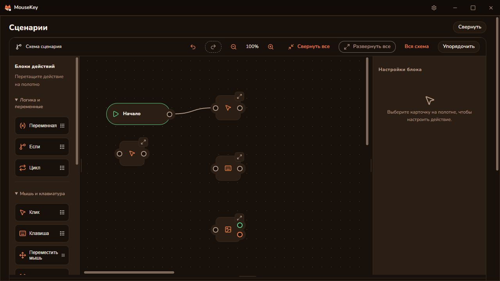

### MouseKey 0.15.1

«Упорядочить» учитывает видимые размеры блоков и размещает свёрнутые квадраты плотнее.

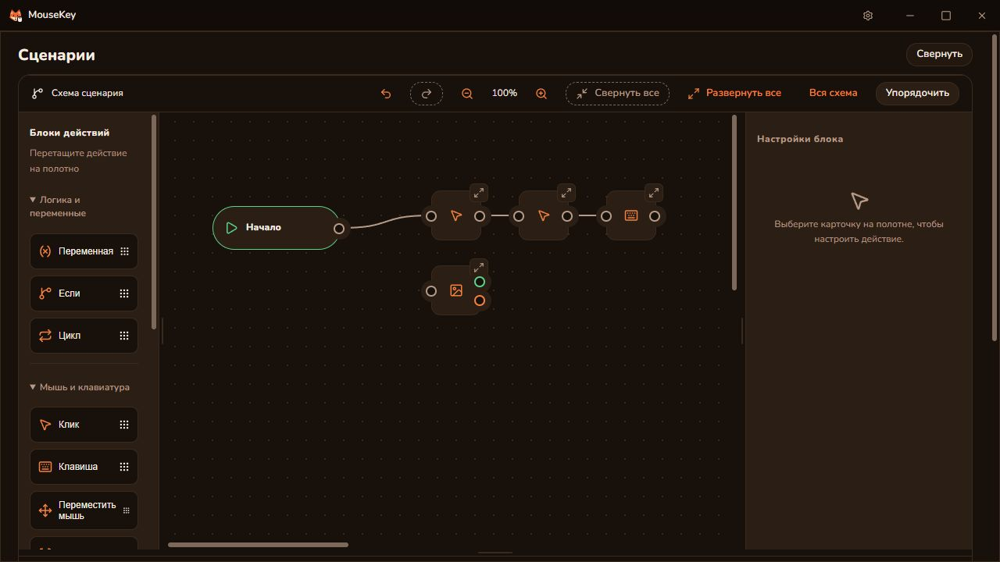

### MouseKey 0.16.0

Аккаунты и карточки компьютеров, постоянный доступ и управление при наведении.

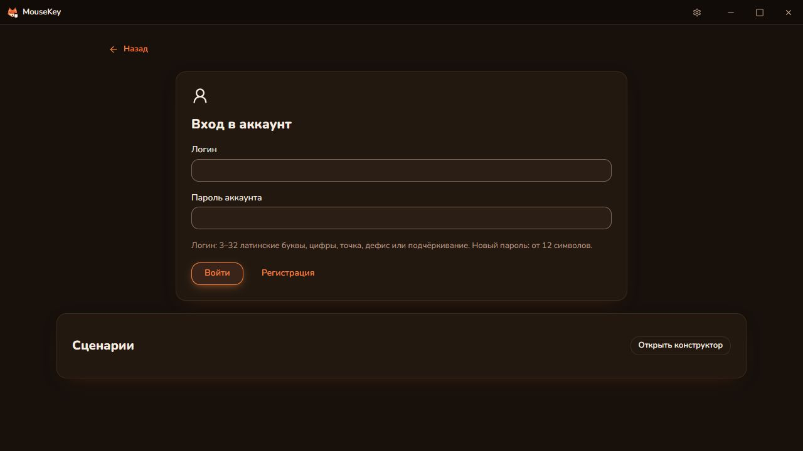

### MouseKey 0.17.0

Временные ключи доступа с отзывом, две колонки подключения, восстановление автотрансляции, видимый курсор и разворачивание с сохранением шапки приложения.

### MouseKey 0.18.1

Исправлены видимость и позиционирование курсора при ESP. Автозахват передаёт компактные кадры, адаптирует разрешение к нагрузке и показывает диагностику захвата и кодирования. Обновите оба ПК; перепрошивать ESP не нужно.

### MouseKey 0.19.1

Исправлены временные метки и восстановление видеопотока, системный локальный курсор и диагностика FPS. Оптимизированы отправка мыши, буфер обмена и передача файлов; усилены ограничения памяти и защита интерфейса. Обновите оба ПК; перепрошивать ESP не нужно. Лимит файла — 64 МиБ. Работа с 6–8 реальными ПК одновременно ещё требует проверки.

### MouseKey 0.19.2

Время захвата и обработки GPU-кадра теперь входит в заданный период кадров: убрана дополнительная пауза после обработки. Обновите оба ПК; перепрошивать ESP не нужно. Проверено локально; задержка на реальных удалённых ПК зависит от сети и оборудования.

### MouseKey 0.19.3

Диагностика показывает ожидание в буфере и обработку на приёмнике. Высокий RTT сам по себе больше не снижает качество при стабильной передаче. Обновите оба ПК; перепрошивать ESP не нужно.

### MouseKey 0.19.4

Первый готовый GPU-кадр включает нативную трансляцию без ожидания опроса. Отправка использует оставшийся срок свежести кадра. Обновите оба ПК; ESP и сервер обновлять не требуется.

### MouseKey 0.19.5

Пустые попытки GPU-захвата до первого кадра теперь соблюдают выбранный FPS. В диагностику видеомодуля добавлен счётчик попыток. Обновите оба ПК; ESP и сервер обновлять не требуется.

### MouseKey 0.19.6

При обновлении только указателя GPU-захват повторно использует неизменившуюся текстуру рабочего стола, избегая лишнего полного копирования. Обновите оба ПК; ESP и сервер обновлять не требуется.
