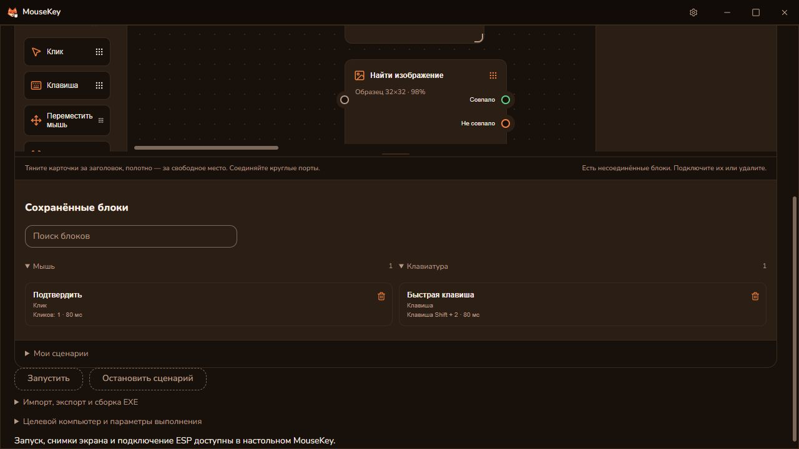
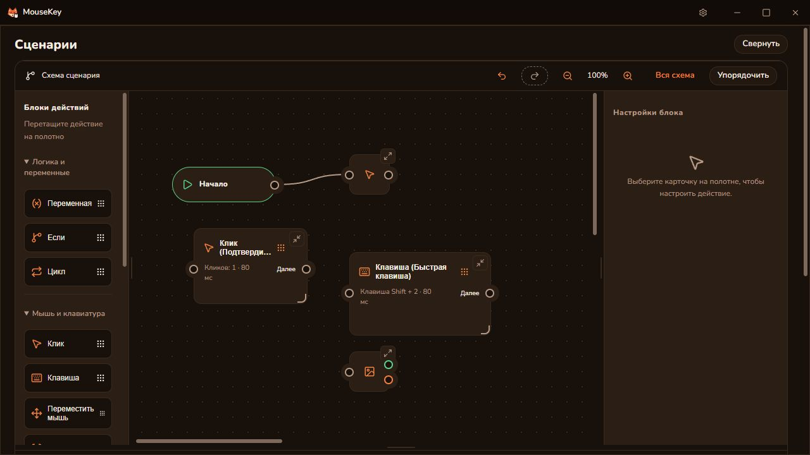
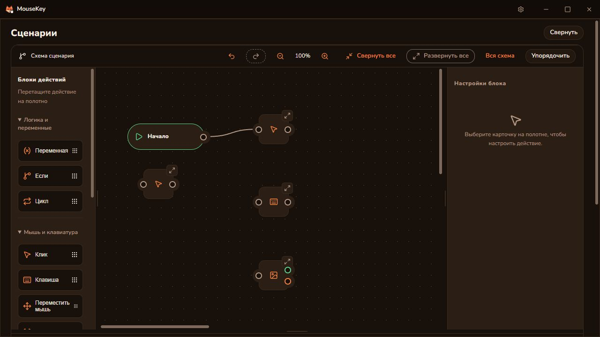
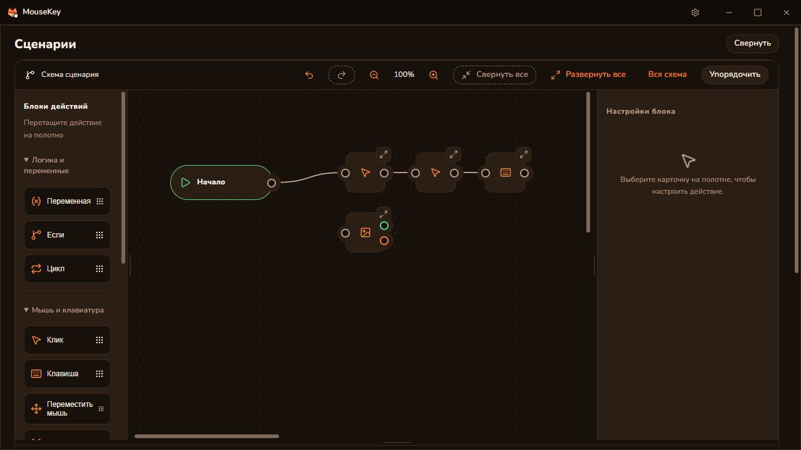
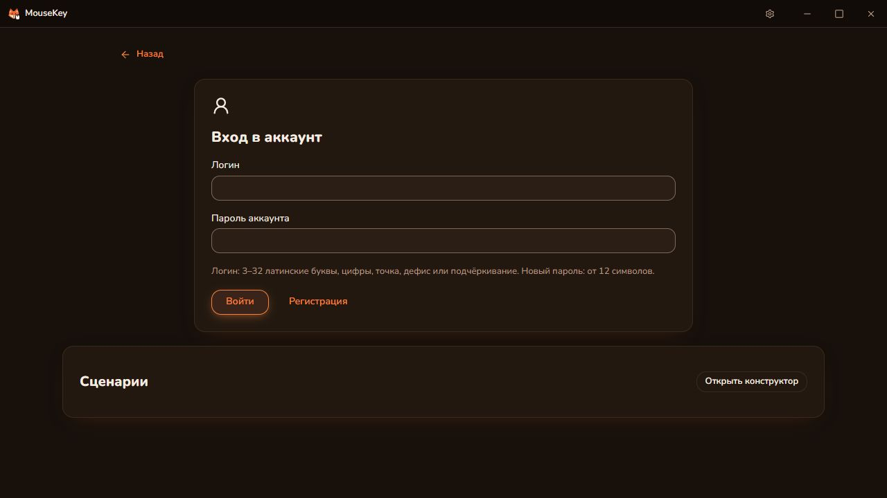

# Historical release highlights

These are historical descriptions, not the 0.27.0 guide. Native video and hover-based control described below were subsequently replaced. [Current guide](scenarios.en.md) · [Persistent access](access.md).

### MouseKey 0.13.1

Saved blocks below the canvas; auxiliary controls stay collapsed.

### MouseKey 0.14.0

Collapse blocks to icons while keeping their connections and expanded dimensions.

### MouseKey 0.15.0

Collapse all and Expand all control the entire diagram. Resize handles no longer cover connection ports.

### MouseKey 0.15.1

Arrange uses visible block dimensions and packs collapsed icon squares closer together.

### MouseKey 0.16.0

Accounts and computer cards, persistent access and hover control.

### MouseKey 0.17.0

Revocable temporary access keys, side-by-side connection panels, automatic sharing recovery, a visible cursor and maximization that preserves the app header.

### MouseKey 0.18.1

Fixed local cursor visibility and ESP desktop positioning. Automatic capture transfers compact frames, adapts resolution to host load and reports capture/encoding diagnostics. Update both PCs; no ESP firmware update is needed.

### MouseKey 0.19.1

Fixed video timestamps and recovery, the system local cursor and FPS diagnostics. Improved mouse transmission, clipboard synchronization and file transfers; bounded memory and hardened the interface. Update both PCs; no ESP firmware update is needed. File limit: 64 MiB. Simultaneous operation with 6–8 actual remote PCs still requires validation.

### MouseKey 0.19.2

GPU capture and processing now consume the configured frame interval, removing the extra wait after processing. Update both PCs; no ESP firmware update is needed. Validated locally; real remote latency depends on network and hardware.

### MouseKey 0.19.3

Diagnostics now show buffer waiting and receiver processing. High RTT alone no longer reduces quality on a healthy connection. Update both PCs; no ESP firmware update is needed.

### MouseKey 0.19.4

The first ready GPU frame activates native playback without waiting for polling. Sending uses the remaining frame freshness deadline. Update both PCs; no ESP firmware or server update is required.

### MouseKey 0.19.5

Empty GPU capture attempts before the first frame now respect the selected FPS. Native video diagnostics include a capture-attempt counter. Update both PCs; no ESP firmware or server update is required.

### MouseKey 0.19.6

Pointer-only updates reuse the unchanged desktop GPU texture instead of making another full copy. Update both PCs; no ESP firmware or server update is required.

### MouseKey 0.19.7

The native encoder handles receiver keyframe requests to recover video after loss. Repeated requests are coalesced. Update both PCs; no ESP firmware or server update is required.

### MouseKey 0.19.8

Restored pre-0.18.1 ESP movement, fixed local cursor dimensions and stream fullscreen. Added host input-error reporting and queue-pressure-aware quality adaptation. Update both PCs; ESP firmware changes are not required.

### MouseKey 0.19.9

Restored browser streaming. Automatic and manual sharing use the same capture and WebRTC; the separate native video channel and additional adaptation are disabled. Update both PCs. Automatic screen selection applies after restarting instance #1 with auto sharing enabled; manual sharing in that instance also selects automatically.

### MouseKey 0.20.0

Added mouse-wheel actions and account-backed scenarios with reference images. Sign in and select Save under My scenarios; on another PC, select Load from account. Local autosave remains available, and conflicting writes cannot silently overwrite newer server data. Update both PCs; ESP firmware is unchanged.
