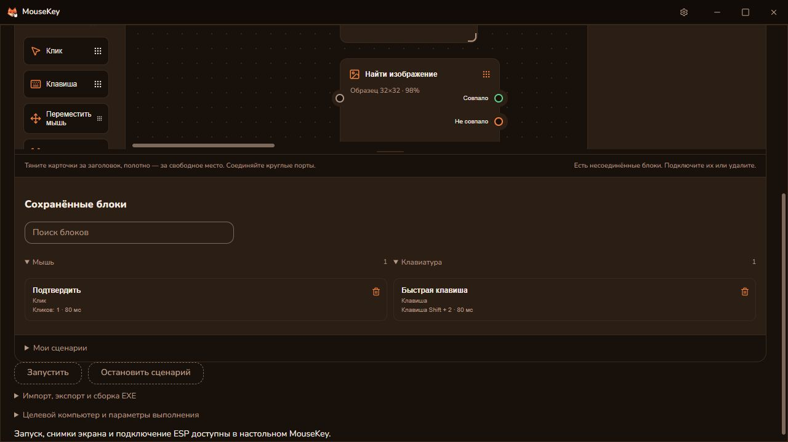
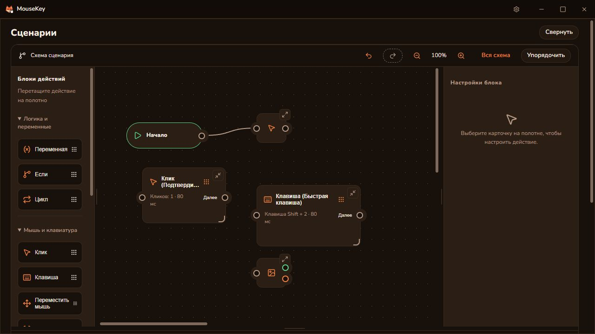
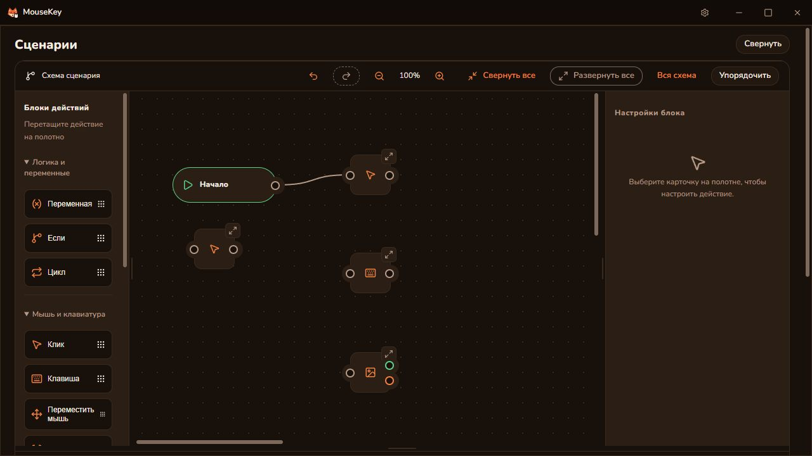
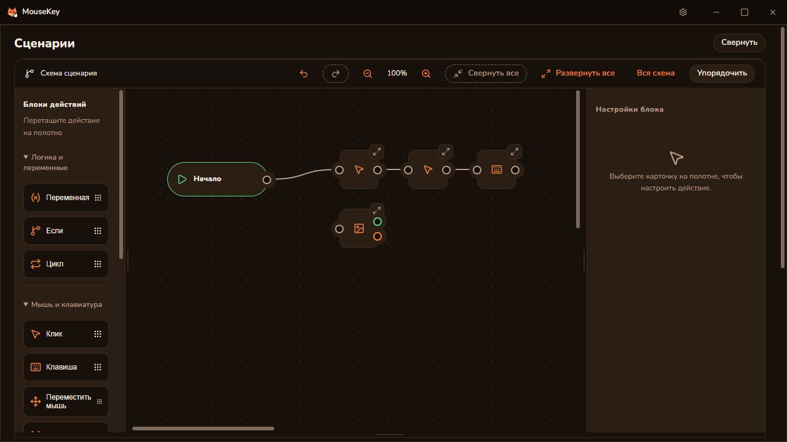
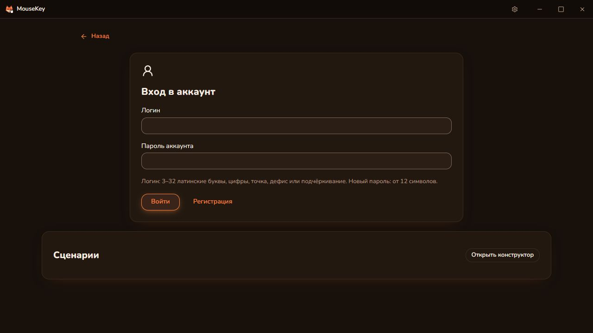

# Исторические заметки о выпусках

Это прежние описания версий, не инструкция к 0.27.0. Нативное видео и управление по наведению из старых заметок позднее заменены. [Актуальное руководство](scenarios.md) · [Постоянный доступ](access.md).

### MouseKey 0.13.1

Сохранённые блоки под полотном; дополнительные настройки свёрнуты.

### MouseKey 0.14.0

Кнопка на блоке сворачивает его до иконки, сохраняя связи и прежний размер.

### MouseKey 0.15.0

«Свернуть все» и «Развернуть все» меняют вид всей схемы. Порты больше не перекрываются ручками размера.

### MouseKey 0.15.1

«Упорядочить» учитывает видимые размеры блоков и размещает свёрнутые квадраты плотнее.

### MouseKey 0.16.0

Аккаунты и карточки компьютеров, постоянный доступ и управление при наведении.

### MouseKey 0.17.0

Временные ключи доступа с отзывом, две колонки подключения, восстановление автотрансляции, видимый курсор и разворачивание с сохранением шапки приложения.

### MouseKey 0.18.1

Исправлены видимость и позиционирование курсора при ESP. Автозахват передаёт компактные кадры, адаптирует разрешение к нагрузке и показывает диагностику захвата и кодирования. Обновите оба ПК; перепрошивать ESP не нужно.

### MouseKey 0.19.1

Исправлены временные метки и восстановление видеопотока, системный локальный курсор и диагностика FPS. Оптимизированы отправка мыши, буфер обмена и передача файлов; усилены ограничения памяти и защита интерфейса. Обновите оба ПК; перепрошивать ESP не нужно. Лимит файла — 64 МиБ. Работа с 6–8 реальными ПК одновременно ещё требует проверки.

### MouseKey 0.19.2

Время захвата и обработки GPU-кадра теперь входит в заданный период кадров: убрана дополнительная пауза после обработки. Обновите оба ПК; перепрошивать ESP не нужно. Проверено локально; задержка на реальных удалённых ПК зависит от сети и оборудования.

### MouseKey 0.19.3

Диагностика показывает ожидание в буфере и обработку на приёмнике. Высокий RTT сам по себе больше не снижает качество при стабильной передаче. Обновите оба ПК; перепрошивать ESP не нужно.

### MouseKey 0.19.4

Первый готовый GPU-кадр включает нативную трансляцию без ожидания опроса. Отправка использует оставшийся срок свежести кадра. Обновите оба ПК; ESP и сервер обновлять не требуется.

### MouseKey 0.19.5

Пустые попытки GPU-захвата до первого кадра теперь соблюдают выбранный FPS. В диагностику видеомодуля добавлен счётчик попыток. Обновите оба ПК; ESP и сервер обновлять не требуется.

### MouseKey 0.19.6

При обновлении только указателя GPU-захват повторно использует неизменившуюся текстуру рабочего стола, избегая лишнего полного копирования. Обновите оба ПК; ESP и сервер обновлять не требуется.

### MouseKey 0.19.7

Нативный кодировщик обрабатывает запросы ключевого кадра для восстановления изображения после потерь. Частые повторы объединяются. Обновите оба ПК; прошивку ESP и сервер менять не нужно.

### MouseKey 0.19.8

Возвращено движение через ESP, как до 0.18.1; исправлены размер локального курсора и полноэкранный показ трансляции. Добавлены сообщения об ошибках ввода и учёт роста сетевого буфера при адаптации качества. Обновите оба ПК; прошивку ESP менять не нужно.

### MouseKey 0.19.9

Возвращена браузерная трансляция. Автопоказ и ручной показ используют одинаковый захват и WebRTC; отдельный нативный видеоканал и дополнительная адаптация отключены. Обновите оба ПК. Автоматический выбор экрана применяется после перезапуска первого экземпляра с включённым автопоказом; в нём ручной запуск тоже выбирает экран автоматически.

### MouseKey 0.19.10

Управление начинается кликом по трансляции. Ctrl+Space освобождает мышь и клавиатуру; Esc в Windows-приложении передаётся удалённому ПК. Возвращены относительные движения через ESP без обновления прошивки.

Click the stream to control the computer. Ctrl+Space releases input; the Windows app forwards Escape to the remote PC. Relative ESP movement works with the existing firmware.

### MouseKey 0.20.0

Добавлены прокрутка мыши и сохранение сценариев вместе с эталонами в аккаунте. После входа нажмите «Сохранить» в «Мои сценарии»; на другом ПК — «Загрузить из аккаунта». Локальное автосохранение сохраняется, конфликтующие записи не затирают новую серверную копию. Обновите оба ПК; прошивка ESP прежняя.
