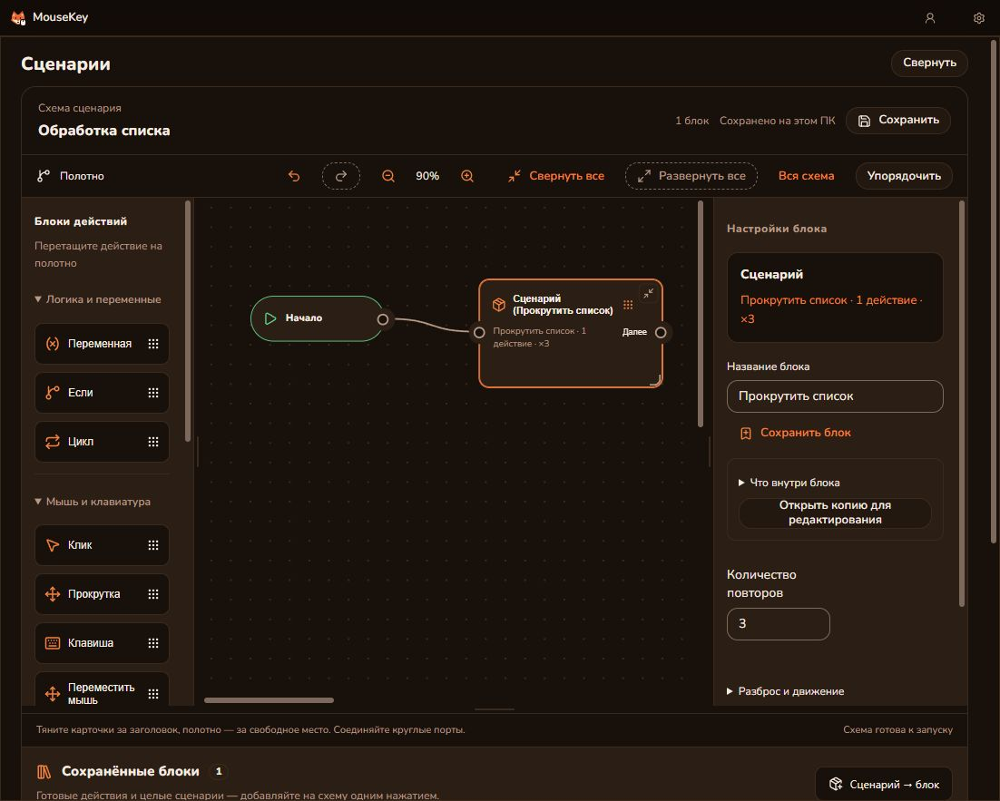

# Сценарий одним блоком / Reusable scenarios

В MouseKey 0.21.0 готовую схему можно превратить в один именованный блок и повторно использовать в других сценариях.

1. Соедините исходную схему от «Начала» до нужных действий.
2. Под полотном нажмите **«Сценарий → блок»**, задайте имя и сохраните.
3. Откройте другую схему. В **«Сохранённых блоках → Сценарии»** нажмите нужную заготовку.
4. Подключите её вход и выход «Далее». Справа можно задать повторы, раскрыть содержимое или открыть отдельную копию для редактирования.

Снимок включает действия, связи, повторы и эталоны изображений. Вставленные копии независимы: изменение исходной схемы их не меняет. Переменные общие с внешним сценарием; отмена останавливает весь запуск.

## Локально и в аккаунте

Заготовка сразу сохраняется в текущем локальном профиле. После входа новая заготовка также отправляется в библиотеку аккаунта, когда она доступна. Статусы локального сохранения и отправки показываются отдельно. Если сеть недоступна или возник конфликт, локальная копия остаётся; после восстановления связи нажмите «Обновить» и «Сохранить в аккаунт».

На другом ПК войдите в тот же аккаунт и нажмите **«Загрузить из аккаунта»**. Это сохранение резервной копии и её явное восстановление, а не непрерывное зеркалирование. Экземпляры MouseKey имеют отдельные локальные профили; библиотеку между ними можно перенести через аккаунт.

Обновите управляющий и управляемый ПК до 0.21.0 для нового блока. **Прошивка ESP остаётся прежней.** Сервер сохраняет заготовки при записи из старого клиента, который ещё не поддерживает это поле.

## Ограничения

До 100 действий суммарно с вложенными сценариями, глубина вложения до 3. Общие отмена и лимит операций защищают от бесконечного исполнения. Незавершённые схемы и действия без обязательного эталона сохранить нельзя. Ожидание конкретного времени по часам оставляйте во внешнем сценарии. При открытии копии расположение внутренних блоков рассчитывается заново.

## English

Connect the source workflow, choose **Scenario → block** below the canvas, name it and save. Open another workflow and select the preset under **Saved blocks → Scenarios**. Connect its input and Next output. The inspector shows repetitions, contents and Open a copy for editing.

Snapshots preserve actions, routes, repeats and reference images. Inserted copies never change automatically. Nested calls share variables, cancellation and the operation budget with the outer workflow.

Presets are saved locally first and uploaded to the available signed-in account. Network failures retain the local copy; refresh and save to the account after reconnecting. On another PC, sign in and choose **Load from account**. This is explicit backup/restore, not continuous synchronization. Local profiles are separate for each instance.

Update both PCs to 0.21.0; existing ESP firmware remains compatible. Limits are 100 total actions and nesting depth 3. Keep absolute-clock waits in the outer workflow. Opening a copy recalculates its internal layout.
