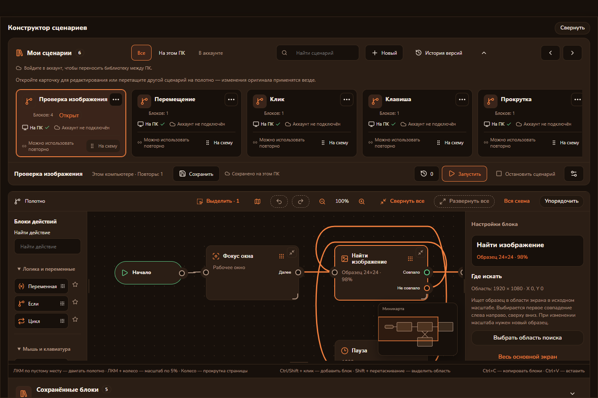
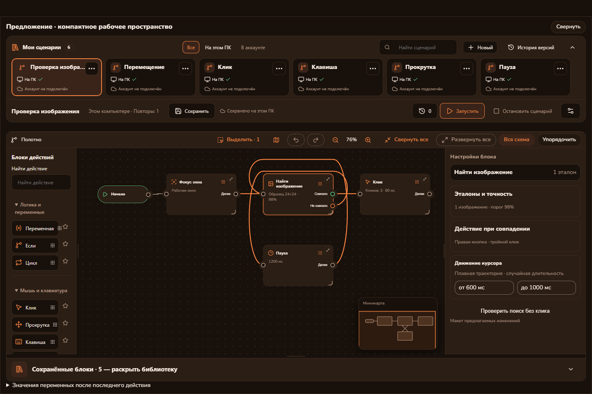

# Аудит интерфейсов сценариев MouseKey 0.27.0

17 ноября 2026 года. **Это результаты проверки и предложения, а не список уже внедрённых изменений.** Актуальное поведение описано в [руководстве](scenarios.md); [English guide](scenarios.en.md).

## Что проверено

Проверен текущий интерфейс из исходников 0.27.0 в изолированном Edge: все 15 типов блоков, библиотека сценариев и блоков, параметры, настройки, история версий/ошибок, выбор области, результат поиска, запуск, длинные названия, пустые состояния и сохранение. Подготовлены 32 снимка состояний; проверены шесть сочетаний палитры/темы. Проверка сохранений включала повтор после ошибки, родительский сценарий, независимые одновременные правки и настоящий конфликт; матрица аккаунта — RU/EN × шесть тем × ширины 360/768/1600.

Основное полотно дополнительно просмотрено на ширинах 600, 800, 1000, 1366 и 1440. Диалог настроек удерживал клавиатурный фокус и возвращал его на кнопку после Esc. Ошибок JavaScript в этих проходах не зарегистрировано. Одно удаление из библиотеки 18 блоков оставило 17; прежнее «съезжание в кучу» в этом проходе не воспроизвелось.

Захват, OCR, исполнение и аккаунт использовали тестовые ответы. Это проверка интерфейса и его состояний, не подтверждение работы ESP, реального распознавания, восьми физических ПК, системного DPI или экранного диктора. Проверка снимков не доказывает плавность анимаций.

## Подтверждённые проблемы

| Приоритет | Проблема и воспроизведение | Что изменить |
|---|---|---|
| Высокий | Валидный сценарий с двумя эталонами 128×128 занимает 393 754 байта в компактной форме, но экспортируется в 1 672 241 байт. Импорт отказывает при 1 МБ | Общий формат и лимит экспорта/импорта; проверка переносимости до скачивания; регрессия «экспорт → импорт» с несколькими эталонами |
| Высокий | При диапазоне движения 600–1000 ввод нижней границы 1100 превращает его в 1100–1100. Флажок случайности снимается и верхнее поле исчезает | Отделить режим «фиксированно/случайно» от равенства чисел; сохранить оба поля при редактировании; явно объяснять некорректные границы |
| Средний | Допустимое длинное имя: карточка 266 px, строка имени 741 px, выход за правую границу более 500 px | Ограничить внутренние колонки и ширину текста; максимум две строки и полное имя в доступной подсказке |
| Средний | Блок перемещения показывает только нижнюю длительность; подписи кликов/поиска не отражают выбранную кнопку и кратность | Краткие метки «600–1000 мс», «ПКМ ×3», «Плавно» и область/координаты; одинаковое резюме на блоке, в панели и заготовке |
| Средний | Подсказка времени движения продолжает говорить «700 мс» при новом диапазоне 600–1000 | Формировать подпись из фактических значений по умолчанию; синхронизировать RU/EN |

Эти проблемы не исправлены обновлением документации. Для диапазона временный порядок — увеличить верхнюю границу первой. Для файлов — проверять обратный импорт и сохранять исходную библиотеку.

## Измерения компоновки

При окне 1440×960 верхняя библиотека занимает около 301 px. Полотно начинается на 510-м пикселе и получает высоту 360 px. При 1366×768 видимая часть полотна до нижней границы окна — примерно 258 px. На ширинах 1000/800/600 верх полотна оказывается примерно на 700/727/826 px: вместо работы пользователь сначала прокручивает служебную часть.

Правая панель при высоте 360 px содержит:

| Блок | Высота содержимого | Полей | Следствие |
|---|---:|---:|---|
| Найти изображение | 2619 px | 23 | Около 7,3 экранов параметров |
| Распознать текст | 1550 px | 13 | Около 4,3 экранов |
| Клик | 1545 px | 13 | Около 4,3 экранов |
| Перемещение | 911 px | 10 | Около 2,5 экранов |

Отсутствие горизонтального переполнения само по себе не делает маленькое окно удобным. Нужны разные компоновки для большого рабочего окна и узкого экземпляра.

## До и предлагаемый вариант

Те же тестовые данные и размер 1440×960. Первый снимок — текущий интерфейс; второй — **макет**, созданный изменением представления в тестовом браузере. Параметры макета не являются реализованными командами приложения.

### Сейчас

### Предложение

Компактные карточки оставляют статусы ПК/аккаунта; второстепенные объяснения раскрываются по запросу. Панель команд остаётся рядом с рабочей областью. Нижняя библиотека становится раскрываемой полкой, правая — группами по смыслу. В этом макете полотно начинается на 361-м пикселе и имеет высоту 503 px вместо 360: примерно на 40% больше высоты при том же окне.

Сохранить утверждённые FoxBrand Toffee/Cocoa/Forest и светлую/тёмную темы. Общие поля, меню, диалоги и сообщения брать из FastDesignSystem с учётом готовности конкретного адаптера; сам граф остаётся специализированным интерфейсом MouseKey.

## Доработки всех зон

| Зона | Предложение | Польза |
|---|---|---|
| Мои сценарии | Компактные карточки, раскрываемый полный каталог, закрепление, теги, сортировка по изменению/имени | Быстро выбирать среди 20 схем без потери половины окна |
| Статусы | Одна понятная строка «На ПК / В аккаунте / Есть изменения», время последней отправки и кнопка повтора | Не путать локальную запись с облачной |
| Меню карточки | Разделить открыть/переименовать/копировать, передачу и удаление; подтверждение называет конкретное место удаления | Меньше ошибочных замен и удаления не той копии |
| Панель запуска | Всегда видимые цель, готовность ESP и остановка; проверка обязательных настроек перед запуском | Не искать причину отказа после старта |
| Левая палитра | Сохранить поиск/избранное; добавить недавние действия и короткий пример при наведении | Понятнее выбирать похожие действия |
| Полотно | Группы с названием/цветом, заметки, направляющие выравнивания, поиск блока, выделение маршрута | Читать большие схемы и разбирать связи |
| Связи | Ясные стрелки направления; обратные линии отдельным маршрутом; подсветка входящих/исходящих связей выбранного блока | Петли не закрывают блоки и не выглядят самопереходами |
| Миникарта | Управление размером/положением и возможность быстро свернуть | Не перекрывать нижние блоки |
| Правая панель | Группы «Основное / Действие / Движение / Дополнительно», закреплённое имя и команда проверки | Основные настройки помещаются в первом экране |
| Несколько блоков | Пакетно менять общие параметры: движение, задержку, название группы; показывать «разные значения» | Настроить старую схему без ручного прохода по каждому блоку |
| Сохранённые блоки | Регулируемая нижняя полка, компактный список/карточки, категории, избранное, меню переименования/обновления | Удобная библиотека без скачков высоты |
| Настройки | Разделы «Выполнение / Перенос / Сборка», контекстная проверка полей | Повседневные параметры не смешиваются с экспортом |
| История версий | Предпросмотр схемы и перечень отличий до восстановления; именованные контрольные версии | Понятно, что именно вернётся |
| Конфликт сохранения | Сравнение «На ПК / В аккаунте», сохранить отдельную копию, явный выбор версии | Разрешать конфликт в одном месте |
| История ошибок | Фильтр по запуску, длительность, цепочка вложенных вызовов, копирование очищенных подробностей | Разбирать причину, а не только находить блок |
| EXE/JSON | Итоговая карточка результата: путь, размер, дата, открыть папку; проверка повторного импорта | Видно, что получилось и пригодно ли для переноса |

## Доработки параметров действий

| Действия | Что добавить/переорганизовать |
|---|---|
| Перемещение и клик | Объединить траекторию, диапазон времени и разброс в одной группе; минипредпросмотр пути; отдельные названия времени движения/удержания/между кликами |
| Клавиша | Визуальные метки сочетания; понятная индикация ожидания ввода; в дальнейшем отдельные действия удержать/отпустить с проверкой баланса |
| Прокрутка | Направление и число делений вместо необходимости помнить знаки; подсказка горизонтального колеса |
| Паузы и часы | Общий переключатель фиксированного/случайного времени; для ожидания часов показывать дату ближайшего срабатывания и целевой часовой пояс |
| Фокус окна | Более понятный список с приложением и заголовком; отдельное действие обновить и диагностика исчезнувшего окна |
| Сравнить изображение | Показ эталона и текущего фрагмента рядом, визуальная карта различий |
| Найти изображение | Результат поверх настоящего снимка, рамка совпадения, номер эталона и оценка; текущая схема результата не показывает контекст экрана |
| Выбор области | «Вписать», 100%, лупа, изменение границ и сдвиг по пикселю; компактные координаты. Поддержку нескольких мониторов планировать отдельно |
| OCR | Одновременно видеть исходный фрагмент, сырой текст и преобразованное число; явно показывать неудачное преобразование |
| Переменные и условия | Общий список имён/типов, автодополнение, места чтения/записи; кнопки «Да/Нет» для условия вместо общего термина совпадения |
| Циклы | Видимый тип цикла и выход; настройка ограничения по времени/итерациям и предупреждение о бесконечной ветке |
| Связанные сценарии | Входные/выходные параметры вместо общих имён переменных; явная маркировка «связь/снимок»; выбор закреплённой версии как дополнительная возможность |

## Выполнение и отладка

Следующий полезный шаг — «Пауза / Продолжить / Один шаг», точки останова и просмотр значений переменных. Это потребует изменений исполнителя, а не только кнопок. Отдельно нужен режим проверки схемы без отправки ввода: доступность ESP/окна, обязательные эталоны, допустимые связи и ограничения. Уже существующую проверку поиска изображения без клика сохранить.

Подсветка выполняемого блока уже есть. Для очень быстрых шагов и вложенных сценариев полезнее добавить последовательность событий с длительностью: периодический опрос может пропустить короткое состояние. «Запуск с блока» должен явно напоминать о пустых начальных переменных.

## Доступность и анимации

Автоматический проход одного английского экрана отметил 18 элементов одной категории: видимая подпись не полностью совпадает с доступным именем. Исправить формирование названий и проверить диктором; это не 18 независимых поломок. Клавиатурная проверка диалога настроек прошла, но не заменяет проверку всего приложения.

Уже используются анимации перестановки библиотеки и системное уменьшение движения. Доработать единообразие: короткий переход выделения, раскрытия групп и появления уведомлений; не анимировать следование полотна за мышью с задержкой. Дополнительно проверить быстрое многократное удаление/отмену, смену reduced motion во время эффекта и производительность на слабом ПК. Для мелких подписей увеличить читаемость; сохранить различение состояний не только цветом.

## Рекомендуемый порядок

1. **Надёжность:** экспорт/импорт, случайный диапазон, длинные названия, достоверные подписи и подсказки.
2. **Рабочая площадь:** компактная верхняя лента, полотно на оставшуюся высоту, группы справа, нижняя раскрываемая библиотека, узкое окно.
3. **Настройка и проверка:** пакетное движение для выделения, реальный предпросмотр поиска/OCR, сравнение версий и понятное разрешение конфликта.
4. **Сложные сценарии:** пошаговое выполнение, точки останова, параметры вложенных сценариев, группы/заметки и события исполнения.

Критерии приёмки: обратный импорт собственных файлов в пределах заявленного лимита; диапазон не выключается при правке; имя до 120 символов не ломает карточку; при 1366×768 основная рабочая область доступна без прокрутки служебных подсказок; проверены обе локали, шесть тем, клавиатура и системное уменьшение движения. Для сохранений отдельно оставить проверки восьми сессий, ошибок сети и восстановления.

## English summary

This audit covers 15 action types, scenario/preset libraries, inspectors, dialogs, capture/search previews, history, execution state and account save states using isolated browser fixtures. It does not certify ESP hardware, real OCR/capture, eight physical PCs, native DPI or screen-reader behavior.

Confirmed issues: valid image-heavy exports can exceed their own import limit; editing a lower motion bound above the upper bound disables random mode; long titles overflow; block summaries omit relevant settings; the 700 ms motion hint is stale. These remain open in 0.27.0.

The proposal keeps the approved brand and makes the top shelf compact, gives remaining height to the graph, groups inspector controls and collapses the bottom library. At 1440×960 the illustrative prototype offers 503 px canvas height instead of 360. It is a proposal, not an implemented update.

Next stages: fix the reproducible defects, improve workspace density, add bulk settings and real search/OCR previews, compare versions/conflicts, then introduce step execution/breakpoints and reusable-scenario parameters. Existing minimap, execution highlight, copy/paste, usages and version history should be improved rather than presented as missing features.
