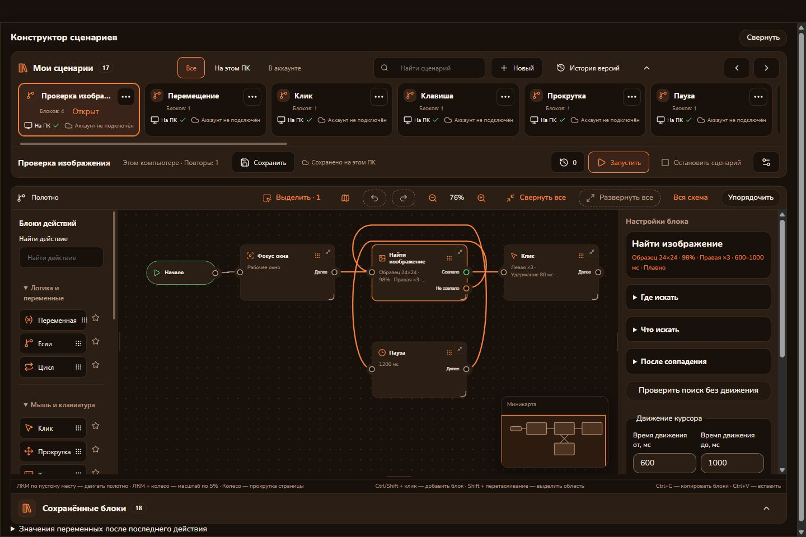
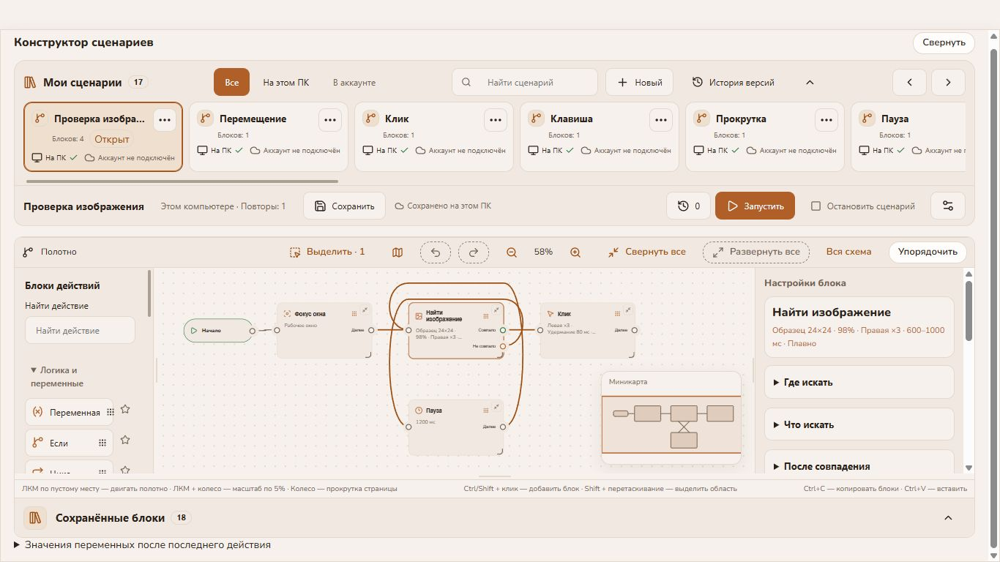

# Конструктор сценариев 0.28

Выпуск исправляет пять воспроизведённых ошибок [аудита 0.27](scenario-interface-audit-2026-11-17.md) и внедряет компактную компоновку предложенного макета.

## Что изменилось

| Зона | Поведение |
|---|---|
| Верхняя библиотека | Компактные карточки, сохранённые отметки ПК/аккаунта, длинное имя обрезается внутри карточки и доступно полностью в подсказке. Вставка и места использования доступны через меню. |
| Полотно | Автоматическая высота учитывает фактические панели, а не запас в 240 пикселей. Ручное изменение высоты имеет приоритет. На узком окне боковые панели по-прежнему открываются отдельно. |
| Поиск и OCR | Группы «Где искать», «Что искать», «После совпадения» и настройки результата раскрываются независимо. Проверка не перемещает курсор и не кликает. |
| Движение | Два поля диапазона остаются видимыми при равенстве границ во время редактирования. Плавная траектория рядом с длительностью; пояснение использует актуальные значения 600–1000 мс. |
| Несколько блоков | Ctrl/Shift + клик выбирает группу. Справа можно применить общий диапазон и траекторию к действиям с перемещением. Связанные сценарии меняются в оригинале. Применение отменяется одним шагом. |
| Нижняя библиотека | По умолчанию свёрнута. Раскрытый список ограничен по высоте, имеет поиск, категории и восстановление удалённого блока. |
| Экспорт | Компактная запись с проверкой обратного чтения. Старое форматирование больше не расходует весь лимит данных. |

## Границы этого выпуска

Большой список идей из аудита остаётся планом развития: пошаговый отладчик, точки останова, параметры вложенных вызовов, сравнение версий по полям и группы с заметками не входят в 0.28. В этом выпуске реализованы исправления и компоновка макета, группировка параметров и пакетное изменение движения.

Проверки и ограничения тестового стенда перечислены в [заметках выпуска](releases/0.28.0.md). Изменения интерфейса не означают проверку распознавания или ESP на реальном удалённом ПК.

## English

Version 0.28 fixes the five reproduced audit issues and implements the compact layout: smaller scenario cards, measured canvas height, grouped recognition controls and a collapsed bottom library. Multi-selection can apply a travel range/curve without modifying button hold or click intervals; one Undo restores the previous values. Long names stay inside cards. Compact JSON export validates reimport; formatted legacy files retain the original data limits.

The screenshots use real UI components with synthetic data. The audit's broader roadmap—debugger, breakpoints, nested-call parameters, field-by-field version comparison and annotated groups—is not included in this release.
