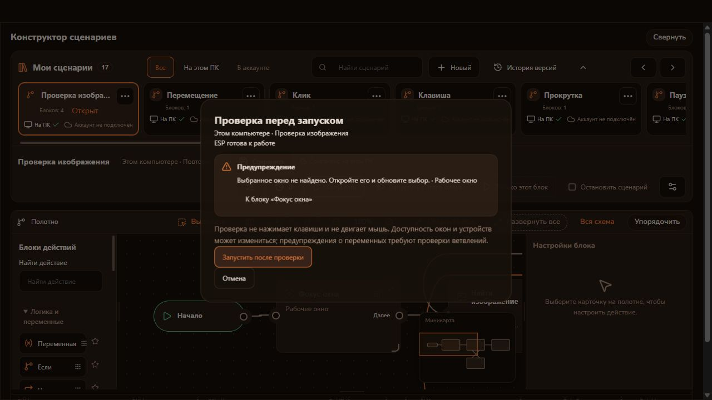
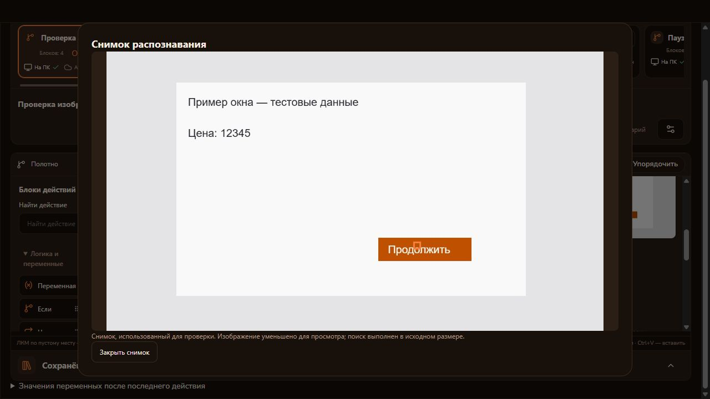
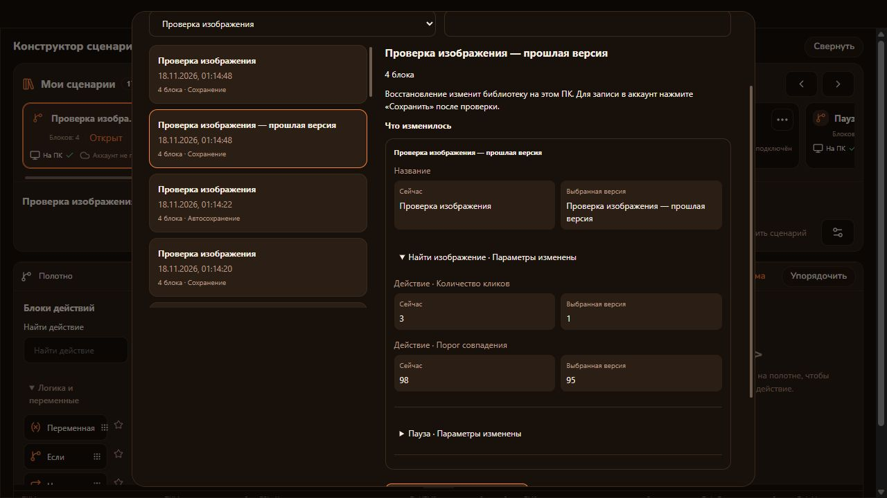

# Конструктор 0.29.0

18 ноября 2026 года. Реализовано в приложении; изображения ниже сняты с реального интерфейса на синтетических данных, без подключения к ESP или производственному аккаунту.

## Проверка перед запуском

Три команды находятся вместе над полотном. Предварительная проверка не отправляет ввод: ошибки блокируют запуск, предупреждения требуют решения пользователя. Переход к блоку закрывает диалог и выделяет его на схеме. Запуск отдельного блока не меняет сохранённую точку начала и число повторов.

## Предпросмотр распознавания

Поиск и OCR возвращают результат вместе с уменьшенным снимком того же буфера пикселей. Не используется второй захват, который мог бы показать другой кадр. Рамка совпадения учитывает исходные координаты области. Изменение параметров скрывает старый результат, запоздавший ответ не подменяет новый выбор. Большой снимок открывается по отдельной кнопке.

## Сравнение версий

История показывает изменения параметров, блоков и связей перед восстановлением; расположение сравнивается отдельно. Учитываются связанные сценарии. Метки времени и обновлённый кэш связанной копии не создают ложных отличий. При конфликте сохранения сравниваются библиотека на ПК и известная версия аккаунта. Содержимое эталонов не выводится массивом чисел.

## Границы проверки

Регрессионные тесты проверяют остановку запуска при ошибках, переход к блоку, одиночный запуск, тело цикла, отсутствие перехода по ветвям, защиту от запоздавших ответов, снимок при отсутствии совпадения, OCR-числа и сравнение зависимостей. Rust-тест проверяет создание миниатюры из переданного RGB-буфера без доступа к рабочему столу.

Проверка доступности окна отражает момент проверки; переменные в циклических ветвлениях анализируются консервативно. Распознавание не запускается автоматически перед каждым сценарием. Физическая ESP, реальное OCR Windows и удалённое выполнение между двумя ПК требуют отдельной проверки. Перед публикацией выполнены локальные проверки и проверка интерфейса; результаты CI и сборки записаны в манифест выпуска.

Новые элементы используют FDS Button/Dialog и существующие токены FoxBrand. Предпросмотр и таблица различий — предметные компоненты MouseKey, отдельные зависимости не добавлены. Прошивка ESP и сервер не меняются.
