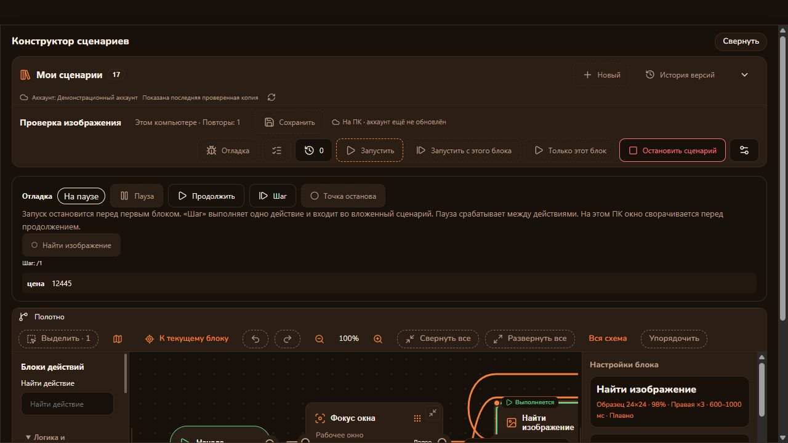
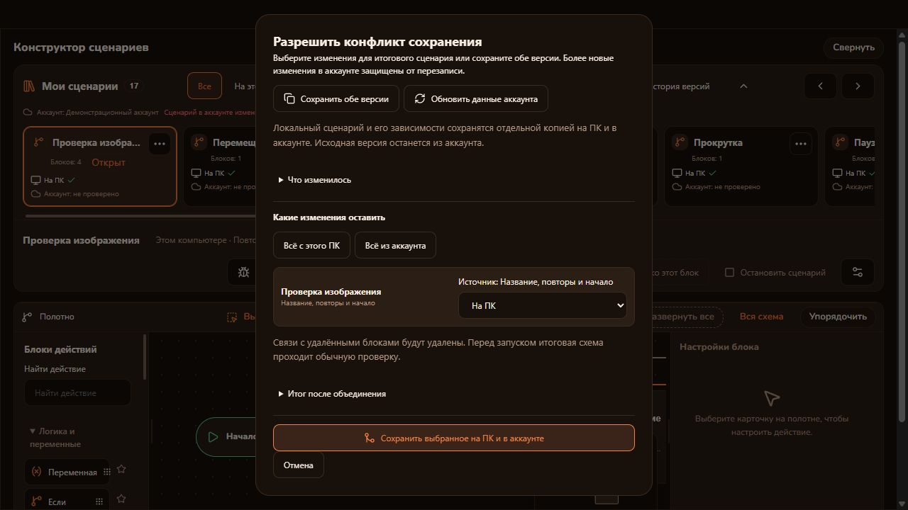

# Конструктор MouseKey 0.30.0

Снимки работающего интерфейса с демонстрационными данными. Команды оборудования и аккаунта заменены тестовыми ответами.

## Отладчик / Debugger

Пауза, продолжение, шаг, точки останова и значения переменных собраны над схемой.

## Конфликты / Conflicts

Выберите изменения для результата или сохраните обе независимые версии. Итог сначала записывается локально, затем отправляется в аккаунт.

[Руководство](scenarios.md) · [English](scenarios.en.md) · [Выпуск](releases/0.30.0.md)
