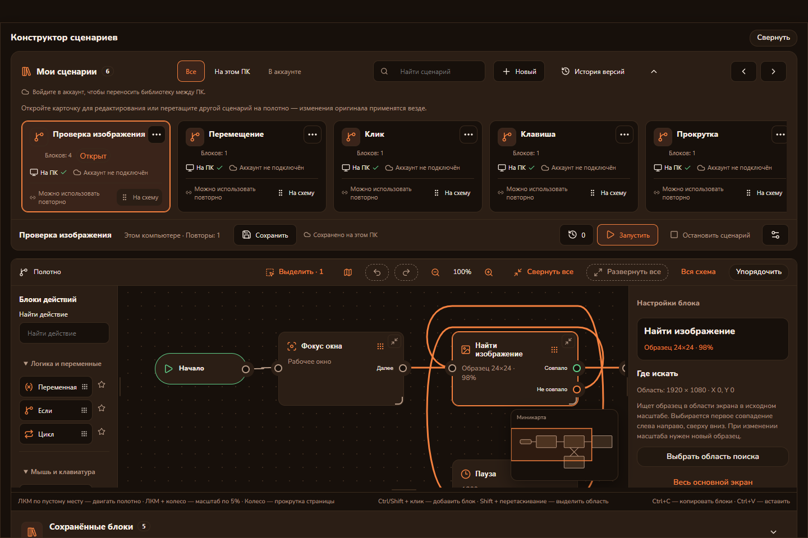

# MouseKey scenarios

Guide for **0.27.0**, reviewed November 17, 2026. [Русский](scenarios.md) · [Reusable scenarios](reusable-scenarios.md) · [Release notes](releases/0.27.0.md).

Scenarios execute on the selected Windows PC through its configured ESP. Capture and OCR run on that PC, independently of compressed streaming video. Remote execution requires updated clients and host permission. Ordinary remote control can use Windows software input without an ESP.

## Getting started

1. Select the target ESP in Settings and open Scenarios.
2. Choose New and set the name/target in Scenario settings.
3. Drag actions from the left palette onto the canvas and connect them to Start.
4. Select a block to edit its parameters on the right. Use a target-screen snapshot for coordinates.
5. Save writes locally and uploads the scenario with dependencies to an available account.
6. Run. Stop scenario or F12 on the target PC cancels execution.

## Workspace

Top cards provide search, local/account filters, per-scenario menus and version history. The command bar has Save, Run, Stop, errors and settings. Actions are on the left, parameters on the right, and independent saved blocks below. The canvas includes a minimap, execution highlighting, fit/arrange and undo/redo. Panels and blocks can be resized. Collapse all compacts the graph; Expand all separates blocks.

| Action | Control |
|---|---|
| Pan | Hold left mouse on empty canvas |
| Zoom | Hold left mouse on empty canvas and scroll, in 5% increments |
| Scroll the page | Wheel without holding left mouse |
| Multiple selection | Ctrl/Shift-click or Shift-drag a rectangle |
| Copy / paste | Ctrl+C / Ctrl+V outside text fields |
| Delete block/link | Select and press Delete |
| Cancel a pending wire | Activate its output again, click empty canvas or Escape |
| Stop a scenario | Stop scenario or F12 on the target |
| Release stream input | Ctrl+Space; separate from stopping a scenario |

Pasting creates new blocks with connections inside the selection, without external links. Scenario settings contains naming, target, remote permission, repeats, coordinates, JSON import/export and EXE packaging. Find usages locates linked scenario callers.

## Saving and recovery

Autosave stores edits in the local instance profile. Save also uploads the current scenario and linked sources to an available account. It does not upload every edit automatically. Local write success and server confirmation are separate states.

“Copies differ” means contents differ, not that someone else necessarily edited them. Refreshing the account list does not replace the open local document. On another PC, sign in and open the account card or choose Download and open. Replacing a different local copy requires confirmation; duplicate it first if both matter. Upload failure leaves the local copy; reconnect/sign in and save again.

Independent changes to different scenarios reconcile on save. Concurrent changes to the same scenario require a choice, not a field-by-field merge. The comparison baseline survives restarts in 0.27.0. An unknown differing copy on first upgrade may require review.

Windows supports 32 separately numbered local profiles and the server allows 32 sessions per account. Eight clients were tested against an isolated server; this does not promise eight lag-free streams or independent system pointers. Deleting from this PC, the account or both leaves other PCs' local copies and independent presets intact. Check source usages before deletion.

Open Version history above the cards. Choose local/account history, date and scenario; the all-scenarios filter includes deleted items. Restore a separate copy or confirm replacing the scenario and dependencies. Current state is checkpointed first. Restore stays local until Save uploads it.

History retains up to 30 snapshots and 32 MB per corresponding local/account history. Local snapshots follow saves, deletion, recovery and an editing pause. The server records the previous library before replacement. History starts with updated client/server versions and cannot recover data lost before then. Error history and version history are separate tools.

## Actions

| Action | Parameters |
|---|---|
| Move | Position, duration, curved travel and random area |
| Click | Button, single/double/triple click, hold and inter-click gap |
| Key | Physical key/chord capture, modifiers, hold duration |
| Scroll | Signed wheel notches; positive means up/right |
| Wait / random wait | Fixed duration or a newly sampled range per execution |
| Wait until | Target PC local time; a past time means tomorrow |
| Window focus | Open window title/class |
| Compare image | Pixel comparison in a fixed region |
| Find image | Up to eight references, region/full-primary-screen search and optional matched click |
| Read text | Windows OCR, text checks and text/number variables |
| Variable | Set, arithmetic operations or delete |
| If | Compare values/variables and select a branch |
| Loop | Count, while, until or continuous mode within execution limits |
| Scenario | Linked source or independent snapshot, with call-specific repeats |

### Motion

New cursor actions use curved travel and a newly sampled **600–1000 ms** duration per movement. Curves vary; endpoints stay fixed unless random positioning is enabled. Travel, button hold and inter-click gaps are separate. Double/triple clicks move once. Find image supports left/right buttons, one/two/three clicks and a random point bounded inside the match.

Existing explicit durations and curve settings remain. Legacy Click/Find image without travel settings use 600–1000 ms. Existing Move actions keep their stored duration. No bulk motion-profile migration is implemented.

### Images and OCR

References are at most 128×128 pixels; search regions can cover the primary display, up to 20 million pixels. Channel tolerance is the maximum difference in each R/G/B channel, 0–255. Match percentage is the required fraction of matching pixels. References are checked in order against one capture; the first match wins and determines click bounds. Test search does not click.

Pixel matching is sensitive to UI scaling and is not neural object recognition. Capture errors stop execution rather than selecting no match. OCR stores text or a numeric result in a variable; choose the region and available Windows language, and verify conversion before a condition.

Run from this block starts a new run with empty variables, skips previous actions and preserves the saved Start. Starting inside a loop does not recreate unreachable outer loop state.

## Portability, limits and known issues

JSON export includes references and portable snapshots of linked calls, not live links to another PC. Windows EXE packaging is in Scenario settings; the recipient still needs Windows and a configured ESP. Account credentials are not embedded.

Limits include 20 documents, 100 total actions with nested calls, nesting depth 3, 200,000 RGB values per run, 100 presets and a 4 MB account library. History has a separate quota. Capture uses the primary monitor; protected/exclusive-fullscreen content may require windowed mode. Reconnection permits a fresh run; interrupted actions are not replayed.

Known 0.27.0 issues, not fixed by this documentation update:

- Pretty-printed JSON can exceed the 1 MB import limit. A valid scenario with two 128×128 references exported to 1.67 MB and failed reimport. Verify reimport before treating a file as your only tested backup. Original local/account data is not deleted.
- Raising minimum travel time above the maximum can turn random mode off. Raise the maximum first and verify the checkbox. The 700 ms hint is stale; new defaults are 600–1000 ms.
- Some block summaries omit details; inspect the right panel. Long names and small windows have layout issues. See the [audit and proposals](scenario-interface-audit-2026-11-17.md).

## Data

Account saves upload scenarios, dependencies, reference images and presets; the server also retains history. This is distinct from encrypted WebRTC streaming. Avoid including secrets in portable text values or references. Scenarios execute on the target, not the server. No ESP firmware update is needed for these features; hardware/application compatibility requires its own tests.
