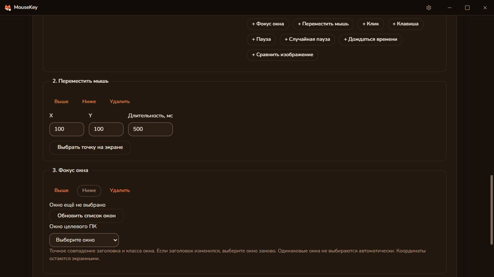

# Сценарии / Scenarios

Раздел MouseKey 0.5.0 для Windows. Он исполняет последовательность
на целевом ПК и передаёт клавиатуру и мышь выбранной плате ESP через существующий
протокол MouseKey. Драйвер Windows для этого не требуется.

## Первый запуск

1. Установите MouseKey из [последнего Windows-релиза](https://github.com/DiFoxenGit/MouseKey/releases/latest). Для удалённой работы нужна
   эта сборка на обоих ПК и обычный сеанс MouseKey по коду и паролю.
2. На целевом ПК откройте настройки ESP, подключите и выберите плату. Её USB
   должен быть подключён к этому же ПК; приложение должно видеть плату по сети.
3. Откройте «Сценарии». Для запуска партнёром включите «Разрешить партнёру сценарии
   и снимки экрана» на целевом ПК. Разрешение не сохраняется между запусками
   и отзывается при завершении сеанса.
4. Выберите место исполнения: этот или удалённый компьютер. Добавьте перемещение,
   клик, клавишу или паузу. X/Y задаются в физических пикселях основного монитора.
   «Выбрать точку на экране» показывает снимок целевого ПК: нажмите в нужную точку нужной кнопкой мыши. Стрелки уточняют выбор на один пиксель. Окно MouseKey кратко скрывается при съёмке; выбранная точка пока не нажимается.
5. Для условия добавьте «Сравнить изображение», задайте X/Y и размер области
   (1–128 пикселя по каждой стороне), затем «Снять эталон». Проверьте миниатюру.
   Окно конструктора не должно закрывать интересующую область при съёмке.
6. Заполните обе ветки. Пиксель совпадает, если отличие каждого RGB-канала не
   превышает допуск. Условие истинно, когда процент таких пикселей не ниже порога.
   При ошибке захвата исполнение прекращается; ветка «не совпало» не запускается.
7. Нажмите «Запустить». Кнопка остановки или F12 на целевом ПК отменяют выполнение.
   Сценарий сохраняется локально; экспорт/импорт JSON переносит его вместе с эталонами.

Пример: область с индикатором совпала → Space на 80 мс; не совпала → пауза 1000 мс.
Повторы повторяют всю последовательность, включая новое сравнение экрана.

## Ограничения проверки

- Связь с выбранной ESP проверяется фоновым потоком каждые 500 мс, независимо от настроек и конструктора. После потери ответов выполняется повторное обнаружение каждые 2 секунды. Выбор платы сохраняется; новый IP принимается только при совпадении известного ID выбранной платы и недоступности старого адреса. Платы без ID восстанавливаются только на прежнем адресе. После возврата связи можно запустить сценарий без повторного выбора в настройках. Прерванный сценарий не продолжается автоматически, ввод не переигрывается.

- Снимок читается на целевом ПК через GDI, а не из сжатого WebRTC-видео.
  Защищённое содержимое и некоторые полноэкранные режимы могут возвращать чёрный
  кадр. Сначала проверьте эталон в оконном режиме или окне без рамки.
- Движение плавное, с обратной связью по позиции системного курсора. Если точка
  не достигнута за заданную длительность плюс 2 секунды, сценарий останавливается
  до следующего клика. Захват курсора игрой может мешать этому режиму.
- Эталон привязан к позиции, разрешению, масштабу интерфейса и отображаемому
  содержимому. Поиска изображения по всему экрану, OCR и выбора второго монитора нет.
- Максимум 100 шагов, 3 уровня условий, 1000 повторов и оценочно 1 час действий/пауз. Ожидание времени суток учитывается отдельно.
- Редактор поддерживает связь с исполнителем раз в секунду. Если она пропала,
  исполнитель останавливается не позднее чем через 5 секунд при очередной проверке.
- Ошибки UDP-отправки возвращаются исполнителю. Протокол платы не подтверждает
  отдельные HID-действия: отправленный пакет не доказывает принятие действия игрой.
  При завершении отправляются три сброса. При обрыве связи с платой или аварийном
  завершении процесса доставка отпускания не гарантируется; текущая прошивка не
  имеет таймера автоматического сброса. При залипании переподключите USB платы.
- Текущий протокол ESP использует 32-битный токен FNV, а не криптографическую
  аутентификацию. Не публикуйте UDP-порт платы в интернете. Удалённая передача
  сценариев идёт через существующий защищённый сеанс WebRTC; доступ к этому
  разделу проверяется в Rust. Сам сценарий содержит данные, а не исполняемый код.
- Невидимость для античита не заявляется. Совместимость с ArcheAge и реальной
  платой этой сборки ещё требует проверки на устройстве.

## Проверки и сборка

`scripts/check-scenarios.ps1` — типы, тесты, сборка интерфейса, Rust fmt/clippy/tests.
`scripts/build-scenarios.ps1` — те же проверки и переносимый EXE со встроенным интерфейсом.
Нужны уже установленные зависимости из lockfile, Node, Rust, MSVC и Windows SDK.
Для JPEG-предпросмотра и его передачи напрямую подключены уже присутствовавшие в lockfile image 0.25.10 и base64 0.23.1, включён JPEG-кодек image. Лицензии MIT/Apache-2.0 (zune также Zlib) совместимы; тексты находятся в docs/licenses/scenarios.

## English

Open **Scenarios**, configure the ESP on the target PC, and build a list of moves,
clicks, keys, waits and image conditions. For remote execution, both PCs need this
build and an ordinary MouseKey session; enable partner scenarios on the host.
Coordinates are physical pixels on the primary display. Capture a 1–128 pixel-wide
and 1–128 pixel-high reference on the target, inspect its preview, and configure
the matching and non-matching branches. Each RGB channel is compared using the
chosen tolerance; the matching-pixel percentage selects the branch. Capture
failure stops execution. JSON export includes reference pixels.

F12 on the target or **Stop scenario** cancels execution. A lost editor connection
expires after 5 seconds. UDP sends are checked, but the firmware does not acknowledge
each HID action or automatically release held input after a network failure.
Reconnect USB if input remains held. This version uses primary-monitor GDI capture;
protected/exclusive fullscreen output may be black. Cursor-locking applications
may prevent positioning. No anti-cheat invisibility or live ArcheAge compatibility
has been verified. Hardware testing is still required.

## Выбор вводом, случайные паузы и часы

- Поле клавиши активируется кликом или Enter. Следующее физическое нажатие
  записывает скан-код, включая extended для стрелок. F12 оставлена для остановки.
  Для выбора кнопки мыши нажмите её в поле кнопки или при выборе точки на снимке.
- Текущие X/Y и часы целевого ПК обновляются каждые 500 мс при открытом редакторе.
  Позиция маркера на снимке и реальная позиция курсора — разные значения.
- «Случайная пауза» выбирает целое число миллисекунд в диапазоне минимум–максимум
  заново при каждом исполнении шага. Это обычная настройка времени, не антидетект.
- «Дождаться времени» использует локальные часы целевого ПК. Укажите HH:mm:ss и
  поставьте после этого шага нужную команду. Если время прошло, ожидание до завтра;
  если ещё не прошло — до сегодня. Проверка часов каждые 100 мс, точность отправки
  зависит также от планировщика ОС и сети. Для этого режима допустимы один шаг
  ожидания времени и один повтор сценария; ожидание можно остановить через F12.
- При запуске окно MouseKey на целевом ПК сворачивается, затем выдерживается 500 мс.
  Для переключения приложения добавьте шаг «Фокус окна» и выберите открытое окно.
- Переносимая тестовая сборка использует отдельный идентификатор данных
  com.difoxen.mousekey.scenarios и отключает автообновление на обычные релизы.

### Input capture and timing (English)

Click the key field and press the desired key; extended scan codes are preserved.
F12 remains the emergency stop. Pick a mouse button by clicking its field, or pick
both button and position on a target-screen snapshot. The host MouseKey window
briefly hides for capture. Live target cursor coordinates and clock update every
500 ms. Random waits sample the inclusive millisecond interval on every execution.
Wait-until steps use the target PC's local HH:mm:ss; past times mean tomorrow.
Only one clock step and one repetition are allowed. Clock checks run every 100 ms;
OS/network scheduling adds latency. The target window minimizes on start; keep the
intended app behind it. This portable test build uses separate application data
and does not auto-update to the stable release.

## Фокус окна / Window focus

Добавьте «Фокус окна», нажмите «Обновить список окон» и выберите окно целевого ПК. Шаг восстанавливает свёрнутое окно и запрашивает фокус обычным Windows API; при отказе Windows, отсутствии или неоднозначности окна сценарий останавливается до следующего ввода. Сопоставляются точные заголовок и класс: если заголовок изменился, обновите выбор. Шаг можно повторять между действиями для переключения приложений. Он не запускает приложение. Координаты остаются экранными.

Add “Focus window”, refresh the target window list and select a window. The step restores a minimized window and requests foreground focus using standard Windows APIs. Missing/ambiguous windows or denied activation stop execution before subsequent input. Exact title and class must match; select again after title changes. Repeat this step between actions to switch applications. It does not launch programs; coordinates remain screen-relative.

Обычный установщик 0.5.0 сохраняет идентификатор MouseKey и автообновления. Отдельный scripts/build-scenarios.ps1 предназначен только для изолированной переносимой тестовой сборки.
The regular 0.5.0 installer preserves MouseKey application data and automatic updates. scripts/build-scenarios.ps1 is only for an isolated portable test build.

## Новые настройки конструктора (0.5.0)

- В каждом блоке раскройте **Разброс и движение**. Пауза перед блоком: 0–60 000 мс. Равные границы задают фиксированное значение. Для клавиши/клика длительность — 20–5000 мс, для перемещения — 100–10 000 мс, для паузы — 20–60 000 мс. Диапазон заменяет фиксированную длительность; он выбирается заново при каждом повторе. Пауза перед ожиданием времени происходит до вычисления следующего наступления этого времени.
- У перемещения/клика включите **Случайная точка внутри области** и выделите прямоугольник либо введите X/Y, ширину и высоту. Каждое исполнение выбирает одну точку внутри него. У клика эта область заменяет фиксированную точку, движение занимает 500 мс. Длительность клика задаёт удержание кнопки.
- **Плавная изогнутая траектория**: новая ограниченная кривая, плавный разгон и торможение, обратная связь по системному курсору. Завершение — в пределах 2 px от выбранной точки; ошибки позиционирования останавливают сценарий. Это не обещание неотличимости от человека.
- Перетаскивайте блок за **Перетащить / перенести** к **Вставить сюда**, в том числе между ветками. Альтернатива мышиному перетаскиванию: нажмите эту кнопку, затем место вставки (доступно клавиатурой и касанием). Escape отменяет перенос. Поместить условие внутрь самого себя нельзя; ограничение вложенности сохраняется.
- **Сравнить изображение → Выбрать область на экране**: выделение прямоугольника, масштаб 1×/2×/4× и численные координаты. Максимум 128×128. Затем **Снять эталон** — отдельный свежий RGB-снимок без JPEG-сжатия; масштаб предварительного просмотра не меняет пиксели эталона.
- **Проверить совпадение сейчас** показывает реальный процент и снимок различий: несовпавшие пиксели красные. Ни одна ветка при проверке не выполняется. Допуск 0 сравнивает RGB точно; порог можно задать с шагом 0,01%. Изменение области сбрасывает эталон и результат проверки. Поиск по экрану и OCR не добавляются.
- Общий объём RGB-эталонов ограничен 200 000 байт; JSON/канал — 1 МБ. Старые сценарии читаются. Для новых настроек обновите приложения на обоих ПК, прошивку ESP менять не нужно.

### New editor controls (0.5.0)

Every block has **Variation and movement** with an optional 0–60,000 ms pre-block pause. Key/click hold ranges are 20–5,000 ms, movement ranges 100–10,000 ms, wait ranges 20–60,000 ms. Equal endpoints are fixed values; a range replaces the fixed duration and is sampled on every execution. A pre-block pause on a clock block runs before calculating its next occurrence.

Mouse moves and clicks can pick a random point inside a rectangle and follow a smooth curved path with acceleration and deceleration. Click positioning takes 500 ms; click duration controls button hold time. Position feedback requires reaching within 2 px of the destination or stops execution. Human indistinguishability is not promised.

Drag blocks between lists/branches or select the move button and an insertion point using keyboard or touch. Escape cancels. Self-nesting and excessive depth are rejected.

Select a reference rectangle up to 128×128 with zoom and numeric coordinates, then capture the uncompressed RGB reference separately. **Test match now** shows the exact percentage, current capture and mismatches highlighted red without executing branches. Thresholds support 0.01% increments; tolerance 0 means exact RGB equality. Changing the region clears the reference/test result. References total at most 200,000 bytes, and JSON/channel payloads at most 1 MB. Update both PCs for new settings; existing scenarios and ESP firmware remain compatible.

ESP connectivity is now maintained in a native background thread (500 ms heartbeat, 2 s rediscovery while offline), even with settings closed. The selected board is retained and a changed address is accepted only for its known ID after the old address expires. Interrupted scenarios remain stopped; input is not replayed. Boards without an ID can recover at their original address.
