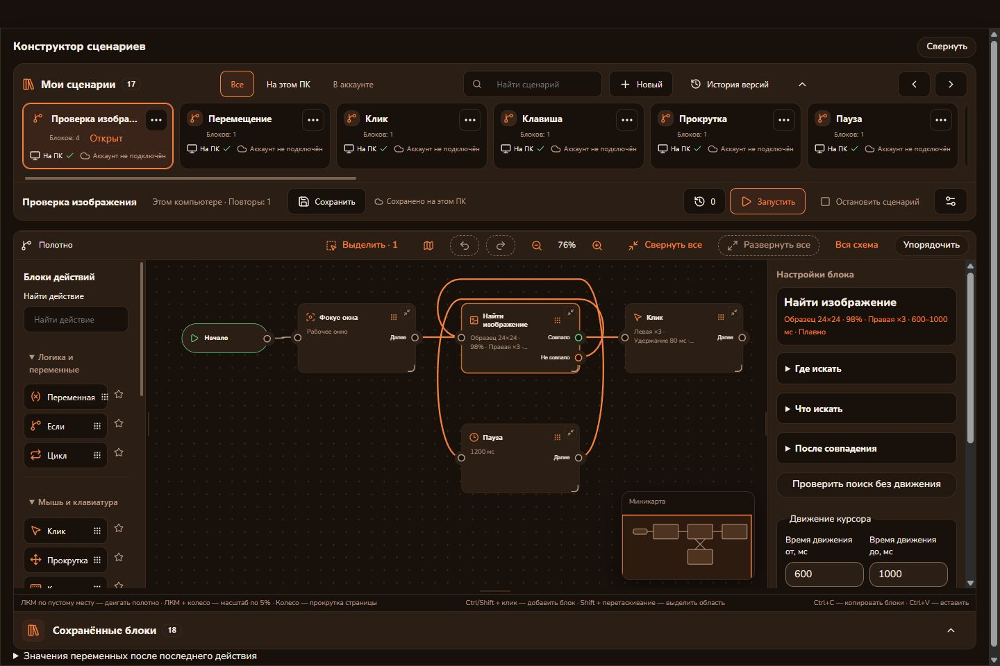

# Сценарии MouseKey

Руководство для **0.29.0**, проверено 18 ноября 2026 года. [English](scenarios.en.md) · [Связанные сценарии и заготовки](reusable-scenarios.md) · [Релиз](releases/0.29.0.md).

Сценарии исполняются на выбранном Windows-ПК через настроенную на нём ESP. Снимки и OCR выполняются на целевом ПК, независимо от сжатого изображения трансляции. Для удалённого запуска обновите оба клиента и разрешите выполнение сценариев на управляемом ПК. Обычное удалённое управление может использовать программный ввод Windows без ESP.

## Быстрый старт

1. Выберите ESP в настройках целевого ПК и откройте «Сценарии».
2. Нажмите «Новый», задайте имя и целевой ПК в настройках сценария.
3. Перетащите действия слева на полотно и соедините их с «Началом».
4. Выберите блок: параметры откроются справа. Для координат используйте снимок целевого экрана.
5. Нажмите «Сохранить»: схема записывается на ПК и отправляется с зависимостями в доступный аккаунт.
6. Проверьте целевой ПК и нажмите «Запустить». «Остановить сценарий» или F12 на целевом ПК останавливает выполнение.

## Рабочее пространство

| Область | Содержимое |
|---|---|
| Верхние карточки | Поиск, фильтры «Все / На этом ПК / В аккаунте», открытие, меню `⋯`, история версий |
| Команды сценария | Сохранение и результат записи, запуск/остановка, история ошибок, настройки |
| Слева | Каталог действий, поиск, избранное |
| Полотно | Блоки, связи, миникарта, подсветка исполнения, масштаб, отмена/повтор, упорядочивание |
| Справа | Параметры блока или команды для выделенной группы |
| Снизу | Сохранённые блоки и независимые снимки сценариев, библиотека аккаунта |

Настройки сценария открываются отдельным окном: имя, целевой ПК, разрешение удалённого выполнения, повторы, координаты, импорт/экспорт JSON и сборка EXE. Панели и блоки меняются по размеру. «Свернуть все» уплотняет схему; «Развернуть все» раздвигает карточки. Это изменение отменяется одним действием.

| Действие | Управление |
|---|---|
| Двигать полотно | Зажать ЛКМ на пустом месте |
| Масштаб | ЛКМ на пустом месте + колесо, шаг 5%; также кнопки масштаба |
| Прокрутить страницу | Колесо без зажатой ЛКМ |
| Выделить несколько блоков | Ctrl/Shift + клик; Shift + перетаскивание для рамки |
| Копировать / вставить | Ctrl+C / Ctrl+V вне текстового поля |
| Удалить блок или связь | Выделить и нажать Delete |
| Отменить незавершённую связь | Повторный клик по выходу, пустое место или Esc |
| Остановить сценарий | Кнопка остановки или F12 на целевом ПК |
| Освободить управление трансляцией | Ctrl+Space; это отдельная команда, не остановка сценария |

Вставка создаёт новые блоки с внутренними связями; связи с невыделенными блоками не переносятся. Миникарта, подсветка выполнения и переход из истории ошибок помогают найти блок. Для связанных сценариев есть поиск мест использования.

## Сохранения и аккаунт

**Автосохранение** хранит изменения локально. **«Сохранить»** подтверждает локальную запись и, при доступном аккаунте, отправляет текущий сценарий и связанные исходники в аккаунт. Это не непрерывная отправка каждого изменения.

| Состояние | Что означает |
|---|---|
| Сохранено на этом ПК | Локальная запись выполнена; отправка в аккаунт ещё не подтверждена |
| Сохранено на ПК и в аккаунте | Последняя подтверждённая сервером копия совпадает |
| Локальные изменения / копии отличаются | Копии различаются; это само по себе не конфликт чужих правок |
| Аккаунт недоступен / нужно войти | Локальная схема остаётся; восстановите соединение/вход и повторите сохранение |
| Сценарий изменён на другом компьютере | Один документ меняли относительно общей версии; обновите список и выберите нужную копию |

Обновление списка аккаунта не заменяет открытый локальный документ. На другом ПК войдите в аккаунт и откройте его карточку либо выберите «Скачать и открыть». Замена отличающейся локальной копии требует подтверждения. Чтобы оставить обе, сначала создайте независимую копию через `⋯`.

Правки разных сценариев из нескольких экземпляров согласуются при сохранении. Правки одного сценария не объединяются по отдельным полям. В 0.27.0 исходная версия сравнения сохраняется между перезапусками; первая неизвестная отличающаяся копия может потребовать явного выбора.

Windows поддерживает до 32 экземпляров с отдельными локальными профилями; сервер допускает до 32 входов в аккаунт. Восемь клиентов проверены на изолированном сервере, но это не гарантия восьми трансляций без задержек. Один системный курсор и одна ESP не становятся независимыми устройствами для каждого экземпляра.

Меню `⋯` удаляет с этого ПК, из аккаунта либо из обоих мест. Локальные копии на других ПК остаются. Перед удалением используемого исходника проверьте места использования. Независимые заготовки не удаляются вместе с исходником.

## История версий

Нажмите «История версий» над карточками. Выберите историю ПК или аккаунта, дату и сценарий; фильтр всех сценариев включает удалённые. Восстановите отдельную копию либо подтвердите замену вместе с перечисленными зависимостями. Перед восстановлением сохраняется текущее состояние.

История хранит до **30 снимков и 32 МБ** на соответствующую локальную историю/историю аккаунта. Локальные снимки создаются после сохранения, удаления, восстановления и паузы редактирования. Сервер сохраняет предыдущую библиотеку перед заменой. Восстановление сначала меняет локальную библиотеку; для отправки нажмите «Сохранить».

История начинается с обновлённых клиента и сервера; уже потерянные данные задним числом не появляются. История ошибок запуска и история версий — разные разделы.

## Все типы блоков

| Блок | Возможности |
|---|---|
| Перемещение | Координаты, длительность, случайная область, изогнутая траектория |
| Клик | Кнопка мыши, 1/2/3 клика, удержание, промежуток между кликами |
| Клавиша | Запись физическим нажатием, сочетания с модификаторами, длительность |
| Прокрутка | Вертикальные/горизонтальные деления колеса: плюс вверх/вправо, минус вниз/влево |
| Пауза / случайная пауза | Фиксированная длительность либо новый выбор из диапазона при каждом выполнении |
| Дождаться времени | Локальные часы целевого ПК; прошедшее время означает следующий день |
| Фокус окна | Выбор открытого окна по заголовку и классу |
| Сравнить изображение | Попиксельное сравнение фиксированной области с эталоном |
| Найти изображение | До восьми эталонов, поиск по области/основному экрану, ветвление, движение и клик |
| Распознать текст | OCR области, проверка текста, текст или число в переменной |
| Переменная | Задать, изменить арифметически или удалить значение |
| Если | Сравнить значения/переменные и выбрать ветку |
| Цикл | Число повторов, пока, до выполнения условия или непрерывно, в пределах бюджета исполнения |
| Сценарий | Связанный исходник или независимый снимок, собственные повторы вызова |

### Движение и клики

У новых действий с перемещением включены плавная изогнутая траектория и случайная длительность **600–1000 мс**, заново для каждого движения. Форма кривой тоже меняется. Конечная точка остаётся заданной, если отдельно не включён разброс координат.

Время движения, удержание кнопки и промежуток между кликами — разные настройки. При двойном/тройном клике курсор перемещается один раз. «Найти изображение» поддерживает левую/правую кнопку, 1/2/3 клика и случайную точку в настраиваемых границах внутри совпадения.

**Существующие сценарии:** явно сохранённые длительности и настройки траектории остаются. Старые «Клик»/«Найти изображение» без времени движения используют 600–1000 мс. Старый блок «Перемещение» с заданным временем не переводится автоматически на случайный диапазон. Массового применения профиля движения пока нет.

### Изображения и OCR

- Эталон — фрагмент до 128×128 пикселей. Область поиска может занимать весь основной экран, до 20 млн пикселей. Размер эталона и область поиска — разные параметры.
- Допуск канала — максимальная разница отдельно в R/G/B, от 0 до 255. Например, 120 при допуске 10 совпадает со 110–130. Процент совпадения — доля пикселей, прошедших сравнение по всем трём каналам.
- Эталоны проверяются по порядку на одном снимке. Используется первое совпадение и размеры его эталона. Проверка поиска не выполняет клик.
- Изменение масштаба/размера объекта может потребовать нового эталона: это пиксельный поиск, не нейросетевое распознавание объектов. Ошибка захвата останавливает выполнение, а не выбирает «Не совпало».
- OCR использует распознавание Windows. Задайте область, язык, проверку и имя переменной. Для цифр выберите числовой результат и проверьте преобразование перед условием. Нужный язык должен быть доступен в Windows.

### Запуск с выбранного блока

Выберите блок и нажмите «Запустить с этого блока» над полотном, рядом с «Запустить». Это новый запуск с пустыми переменными, а не продолжение предыдущего. Ранние действия пропускаются, сохранённое «Начало» не меняется. Для условия с переменной сначала выполните её инициализацию. Старт внутри тела цикла не создаёт недостигнутые внешние повторы.

## Перенос и EXE

Импорт/экспорт JSON и сборка EXE находятся в настройках сценария. JSON включает эталоны и переносимые снимки связанных вызовов: импорт не создаёт живую связь с исходником на другом ПК. EXE собирается в установленном Windows-приложении; получателю нужны Windows и настроенная ESP. Пароль аккаунта в сценарий не включается.

В 0.28 экспорт записывается компактно и проверяется обратным чтением. Форматированные файлы до 4 МБ принимаются, если документ без отступов укладывается в прежний лимит 1 МБ. Лимиты действий и эталонов не увеличены.

## Ограничения и известные проблемы

- До 20 схем в библиотеке, 100 действий с вложенными вызовами, глубина до 3; общий бюджет исполнения и до 200 000 значений RGB на запуск. До 100 сохранённых блоков; серверная библиотека до 4 МБ. История имеет отдельную квоту.
- Координаты и захват относятся к основному экрану. Защищённые/эксклюзивные полноэкранные окна могут не давать пригодный снимок; проверьте оконный режим.
- После восстановления ESP можно снова запустить сценарий. Прерванные действия автоматически не продолжаются и не повторяются.
- Ошибки появляются уведомлениями; история ошибок помогает перейти к месту остановки.
- В 0.28 исправлено редактирование диапазона: равенство границ больше не скрывает второе поле. Настройки движения можно применить к нескольким выделенным блокам.
- Подписи показывают диапазон движения, кнопку и число кликов. Полные параметры остаются справа; [компоновка 0.28 и дальнейшие планы](scenario-workspace-028.md).

## Данные и доступ

Сохранение в аккаунт отправляет на сервер схему, зависимости, эталоны и библиотеку блоков; сервер хранит также историю. Это отличается от зашифрованной трансляции WebRTC. Не включайте секреты в переносимые текстовые значения или эталоны. Сценарии исполняются на целевом ПК, не на сервере.

Прошивка ESP для этих функций не меняется. Отправка команды не гарантирует реакцию конкретного приложения; совместимость оборудования и целевой программы проверяется отдельно.

## Проверка и запуск в 0.29.0

Над полотном рядом расположены «Запустить», «Запустить с этого блока» и «Только этот блок». Для двух последних команд выделите ровно один блок. Проверка выполняется перед каждой командой; кнопка со списком позволяет проверить сценарий отдельно, без запуска.

Проверяются граф и связанные сценарии, параметры и эталоны, границы экрана целевого ПК, доступность выбранной ESP и занятость исполнителя. Ошибки блокируют запуск. Отсутствующее или неоднозначное окно и возможное чтение ещё не заданной переменной показываются предупреждениями. Из списка можно перейти к блоку. Проверка ничего не нажимает и не активирует окна; она не гарантирует, что изображение появится позже или окно останется доступно.

«С этого блока» продолжает по связям. «Только этот блок» выполняет его один раз без перехода к следующему: у цикла выполняется его тело, у вложенного сценария — весь вложенный сценарий. У условий не запускаются исходящие ветви. Переменные при новом запуске создаются заново. Изменение схемы, библиотеки или целевого ПК отменяет подготовленную проверку.

«Проверить поиск без движения» и проверка OCR показывают снимок **того же кадра**, который был распознан. Поиск показывает рамку совпадения, номер эталона и процент; при отсутствии совпадения снимок тоже остаётся доступен. OCR показывает исходный текст и результат преобразования в число. Кнопка «Увеличить снимок» открывает его отдельно. Снимок уменьшен для просмотра; распознавание выполняется в исходном размере. После изменения параметров старый результат скрывается.

В истории версий выберите снимок: «Что изменилось» сравнивает его с текущим сценарием. Параметры, добавленные/удалённые блоки и связи показаны отдельно от расположения блоков. Сравниваются и связанные сценарии; изменение их служебного кэша не считается правкой родителя. При конфликте записи аналогичное сравнение показывает локальную и облачную версии. Смена эталона отмечается без вывода массива пикселей.

Для удалённой проверки и предпросмотра нужны **0.29.0 на обоих ПК** и разрешение сценариев на целевом ПК. Серверный патч и обновление прошивки ESP не требуются.
