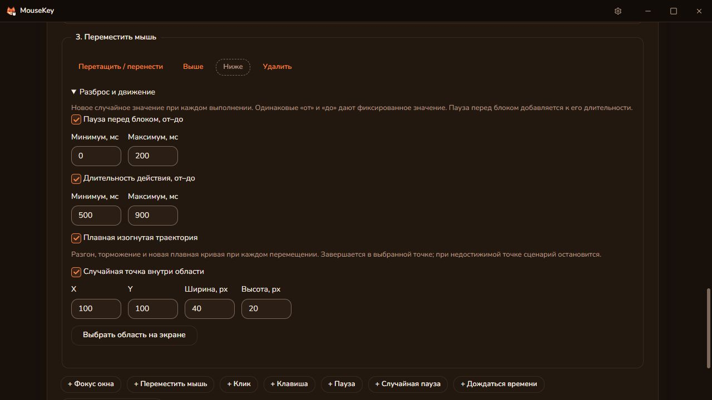
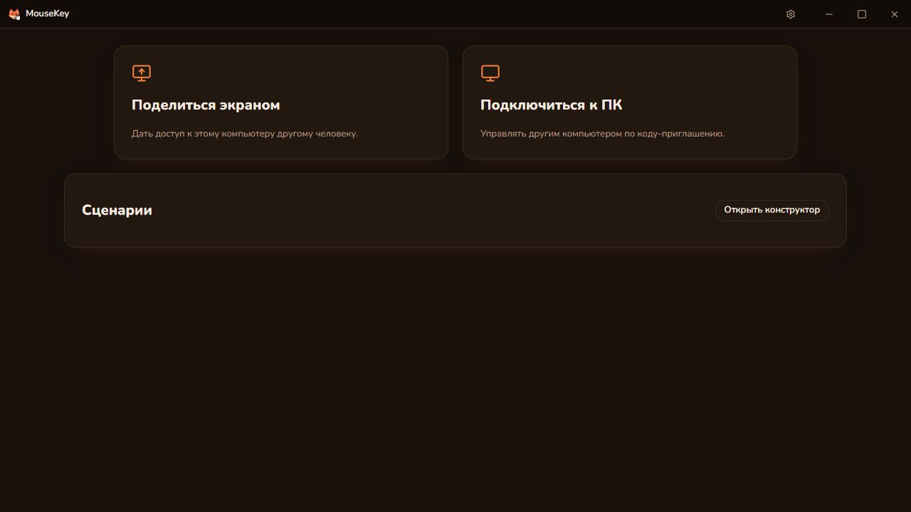
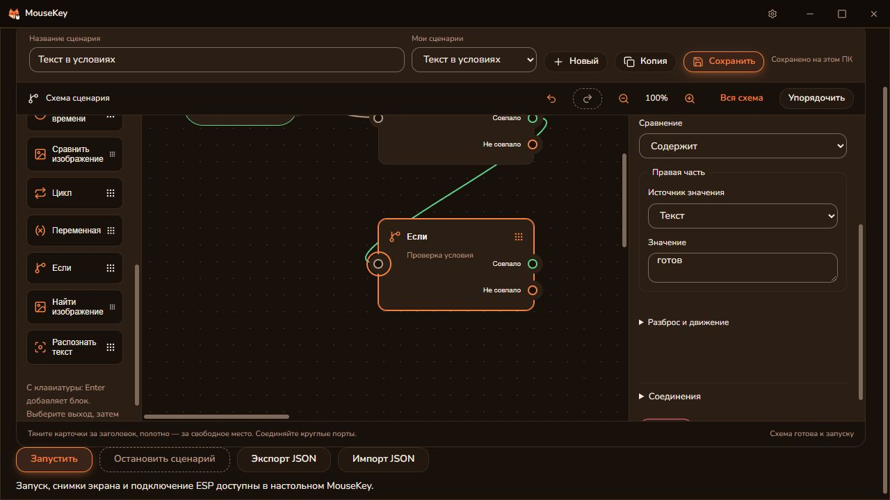
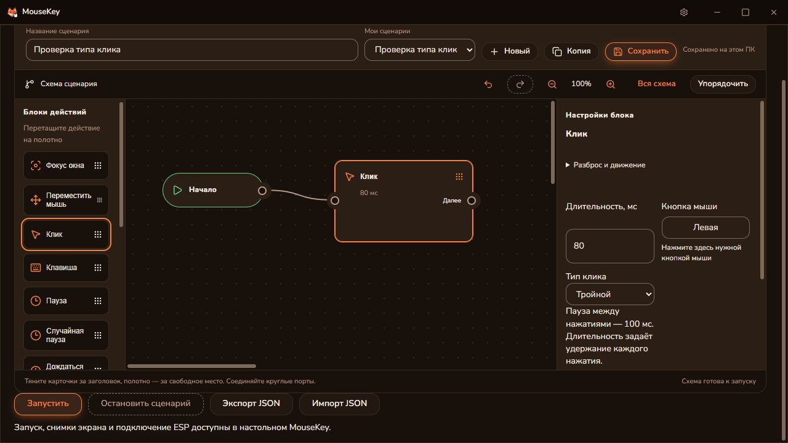
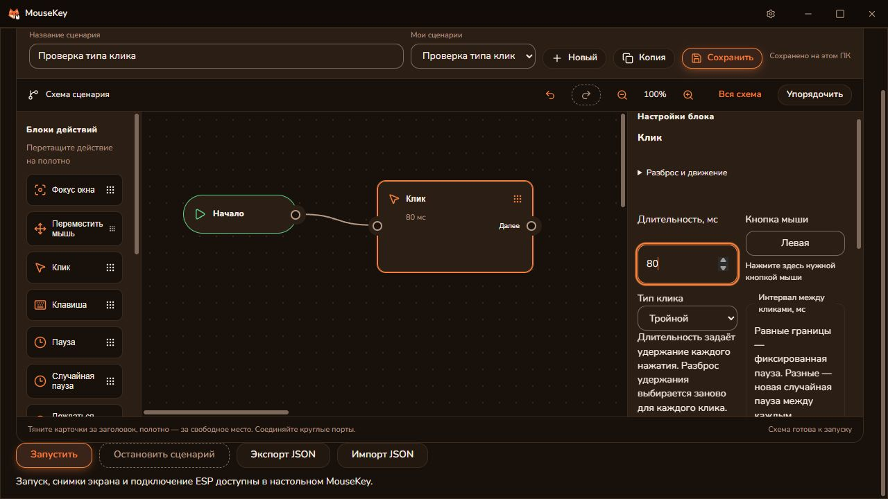
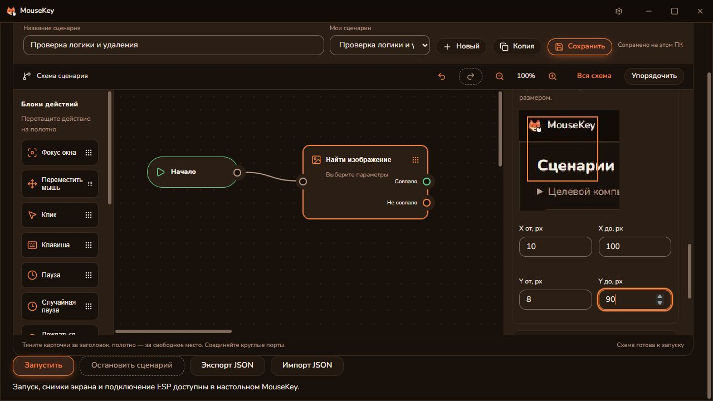
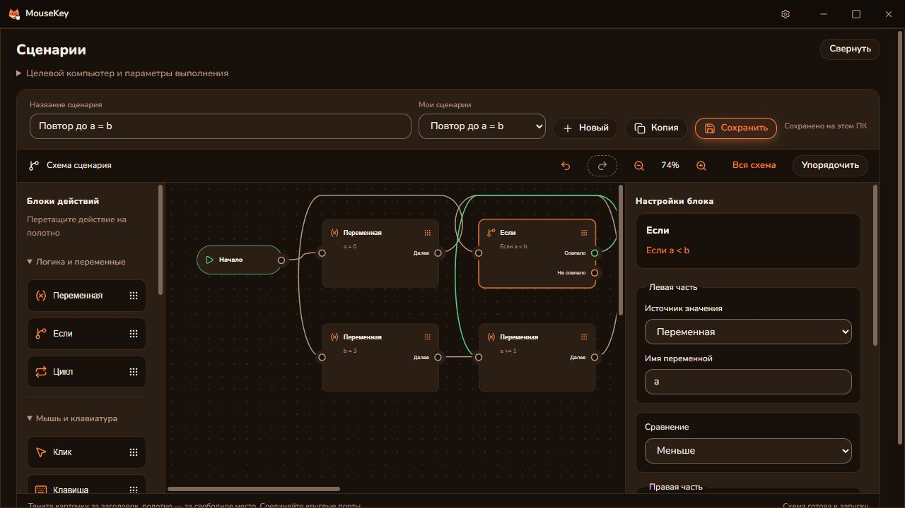
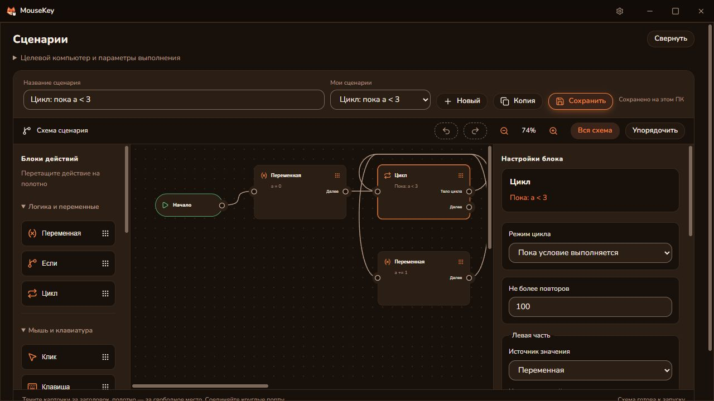
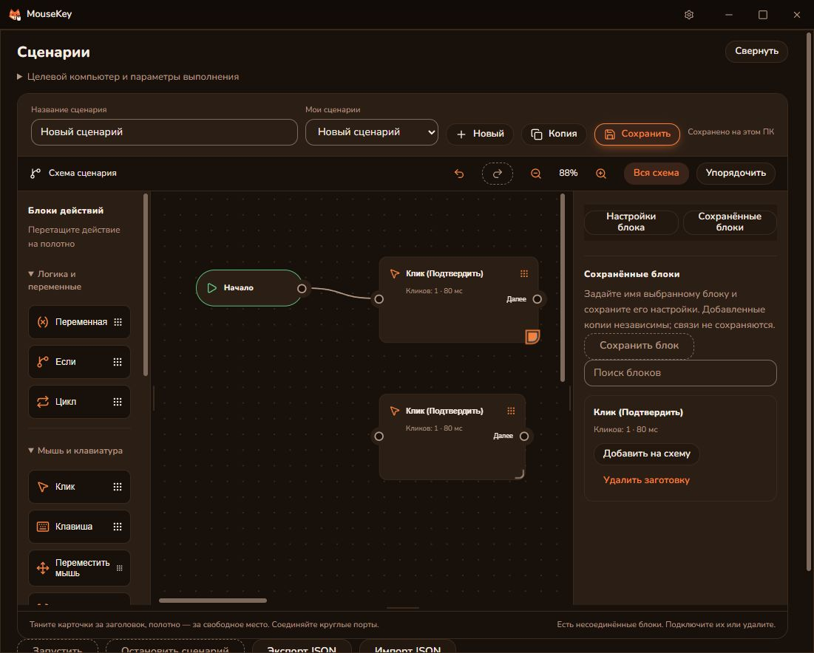

# Сценарии / Scenarios

Раздел MouseKey 0.6.0 для Windows. Он исполняет последовательность
на целевом ПК и передаёт клавиатуру и мышь выбранной плате ESP через существующий
протокол MouseKey. Драйвер Windows для этого не требуется.

## Первый запуск

1. Установите MouseKey из [последнего Windows-релиза](https://github.com/DiFoxenGit/MouseKey/releases/latest). Для удалённой работы нужна
   эта сборка на обоих ПК и обычный сеанс MouseKey по коду и паролю.
2. На целевом ПК откройте настройки ESP, подключите и выберите плату. Её USB
   должен быть подключён к этому же ПК; приложение должно видеть плату по сети.
3. Откройте «Сценарии». Для запуска партнёром включите «Разрешить партнёру сценарии
   и снимки экрана» на целевом ПК. Разрешение не сохраняется между запусками
   и отзывается при завершении сеанса.
4. В «Целевой компьютер и параметры выполнения» выберите этот или удалённый компьютер. Перетащите действие из палитры на полотно. Соедините выход «Начала» со входом первой карточки, затем выходы карточек со входами следующих. Перемещайте карточки за заголовок, полотно — за свободное место. Настройки выбранной карточки находятся справа. X/Y задаются в физических пикселях основного монитора.
   «Выбрать точку на экране» показывает снимок целевого ПК: нажмите в нужную точку нужной кнопкой мыши. Стрелки уточняют выбор на один пиксель. Окно MouseKey кратко скрывается при съёмке; выбранная точка пока не нажимается.
5. Для условия добавьте «Сравнить изображение», задайте X/Y и размер области
   (1–128 пикселя по каждой стороне), затем «Снять эталон». Проверьте миниатюру.
   Окно конструктора не должно закрывать интересующую область при съёмке.
6. Соедините выходы «Совпало» и «Не совпало» с нужными действиями. Общий следующий блок можно подключить к обеим веткам: он выполнится один раз. Пиксель совпадает, если отличие каждого RGB-канала не
   превышает допуск. Условие истинно, когда процент таких пикселей не ниже порога.
   При ошибке захвата исполнение прекращается; ветка «не совпало» не запускается.
7. Нажмите «Запустить». Кнопка остановки или F12 на целевом ПК отменяют выполнение.
   Сценарий сохраняется локально; экспорт/импорт JSON переносит его вместе с эталонами, расположением и связями.

Незавершённую связь отменяет повторное нажатие на тот же выход, клик по пустому полотну или Esc. Уже созданные соединения при этом сохраняются.

## Сохранение и управление схемой

Назовите сценарий и нажмите «Сохранить». Изменения также сохраняются автоматически; надпись «Сохранено на этом ПК» подтверждает запись. «Мои сценарии» переключает сохранённые схемы, «Новый» создаёт пустую, «Копия» дублирует текущую. Библиотека хранит до 20 сценариев, суммарно до 4 миллионов символов JSON. При ошибке записи текущую схему можно экспортировать в файл.

«Вся схема» подбирает масштаб, «Упорядочить» расставляет карточки по связям. Отмена и повтор восстанавливают изменения текущей схемы. С клавиатуры Enter добавляет выбранное действие; для соединения активируйте выход и затем вход, стрелки на заголовке перемещают карточку.

Незавершённую схему можно сохранить. Для запуска все блоки должны быть достижимы от «Начала», с версии 0.12.0 разрешены обратные связи; повтор всей схемы также задаётся параметром повторов. Старые сценарии переносятся автоматически и импортируются из JSON. Новый формат JSON требует MouseKey 0.6.0 или новее.

## Несколько экземпляров Windows

Запустите MouseKey повторно: откроется ещё один экземпляр, его номер виден в заголовке. Настройки, библиотека сценариев, подключение ESP и память положения окна отдельные. Первый экземпляр использует прежние данные; последующие получают собственные сохраняемые профили. При новом запуске используется первый свободный номер (до 32 одновременно).

Сворачивание в трей не освобождает номер — для этого выберите выход из приложения. Для переноса схемы между экземплярами используйте экспорт/импорт JSON. Системный курсор Windows остаётся общим; одновременные команды на одну плату или один компьютер могут мешать друг другу.

Пример: область с индикатором совпала → Space на 80 мс; не совпала → пауза 1000 мс.
Повторы повторяют всю последовательность, включая новое сравнение экрана.

## Ограничения проверки

- Связь с выбранной ESP проверяется фоновым потоком каждые 500 мс, независимо от настроек и конструктора. После потери ответов выполняется повторное обнаружение каждые 2 секунды. Выбор платы сохраняется; новый IP принимается только при совпадении известного ID выбранной платы и недоступности старого адреса. Платы без ID восстанавливаются только на прежнем адресе. После возврата связи можно запустить сценарий без повторного выбора в настройках. Прерванный сценарий не продолжается автоматически, ввод не переигрывается.

- Снимок читается на целевом ПК через GDI, а не из сжатого WebRTC-видео.
  Защищённое содержимое и некоторые полноэкранные режимы могут возвращать чёрный
  кадр. Сначала проверьте эталон в оконном режиме или окне без рамки.
- Движение плавное, с обратной связью по позиции системного курсора. Если точка
  не достигнута за заданную длительность плюс 2 секунды, сценарий останавливается
  до следующего клика. Захват курсора игрой может мешать этому режиму.
- Эталон привязан к позиции, разрешению, масштабу интерфейса и отображаемому
  содержимому. Поиска изображения по всему экрану, OCR и выбора второго монитора нет.
- Максимум 100 шагов, 3 уровня условий, 1000 повторов и оценочно 1 час действий/пауз. Ожидание времени суток учитывается отдельно.
- Редактор поддерживает связь с исполнителем раз в секунду. Если она пропала,
  исполнитель останавливается не позднее чем через 5 секунд при очередной проверке.
- Ошибки UDP-отправки возвращаются исполнителю. Протокол платы не подтверждает
  отдельные HID-действия: отправленный пакет не доказывает принятие действия игрой.
  При завершении отправляются три сброса. При обрыве связи с платой или аварийном
  завершении процесса доставка отпускания не гарантируется; текущая прошивка не
  имеет таймера автоматического сброса. При залипании переподключите USB платы.
- Текущий протокол ESP использует 32-битный токен FNV, а не криптографическую
  аутентификацию. Не публикуйте UDP-порт платы в интернете. Удалённая передача
  сценариев идёт через существующий защищённый сеанс WebRTC; доступ к этому
  разделу проверяется в Rust. Сам сценарий содержит данные, а не исполняемый код.
- Невидимость для античита не заявляется. Совместимость с ArcheAge и реальной
  платой этой сборки ещё требует проверки на устройстве.

## Проверки и сборка

`scripts/check-scenarios.ps1` — типы, тесты, сборка интерфейса, Rust fmt/clippy/tests.
`scripts/build-scenarios.ps1` — те же проверки и переносимый EXE со встроенным интерфейсом.
Нужны уже установленные зависимости из lockfile, Node, Rust, MSVC и Windows SDK.
Для JPEG-предпросмотра и его передачи напрямую подключены уже присутствовавшие в lockfile image 0.25.10 и base64 0.23.1, включён JPEG-кодек image. Лицензии MIT/Apache-2.0 (zune также Zlib) совместимы; тексты находятся в docs/licenses/scenarios.

## English

Open **Scenarios**, configure the ESP on the target PC, drag action cards onto the canvas and connect their ports. Select cards to edit moves,
clicks, keys, waits and image conditions. For remote execution, both PCs need this
build and an ordinary MouseKey session; enable partner scenarios on the host.
Coordinates are physical pixels on the primary display. Capture a 1–128 pixel-wide
and 1–128 pixel-high reference on the target, inspect its preview, and configure
the matching and non-matching branches. Each RGB channel is compared using the
chosen tolerance; the matching-pixel percentage selects the branch. Capture
failure stops execution. JSON export includes reference pixels.

Cancel a pending connection by activating its output again, clicking empty canvas, or pressing Escape. Existing connections are preserved.

Name and save scenarios in the local library; autosave also retains card positions and connections. New, duplicate, undo, redo, zoom, fit and arrange controls are available. Disconnected drafts can be saved but cannot run; back edges are supported starting with 0.12.0. Legacy scenarios migrate automatically. Canvas JSON requires version 0.6.0 or later.

Launch MouseKey again on Windows to open a separate numbered instance with its own settings, library and ESP connection. The first profile retains existing data; subsequent launches reuse the first available profile number, up to 32 simultaneous instances. Closing to the tray keeps that instance running. Export/import JSON to copy a scenario between profiles. Windows still has one system pointer; simultaneous input to the same PC or board can interfere.

F12 on the target or **Stop scenario** cancels execution. A lost editor connection
expires after 5 seconds. UDP sends are checked, but the firmware does not acknowledge
each HID action or automatically release held input after a network failure.
Reconnect USB if input remains held. This version uses primary-monitor GDI capture;
protected/exclusive fullscreen output may be black. Cursor-locking applications
may prevent positioning. No anti-cheat invisibility or live ArcheAge compatibility
has been verified. Hardware testing is still required.

## Выбор вводом, случайные паузы и часы

- Поле клавиши активируется кликом или Enter. Следующее физическое нажатие
  записывает скан-код, включая extended для стрелок. F12 оставлена для остановки.
  Для выбора кнопки мыши нажмите её в поле кнопки или при выборе точки на снимке.
- Текущие X/Y и часы целевого ПК обновляются каждые 500 мс при открытом редакторе.
  Позиция маркера на снимке и реальная позиция курсора — разные значения.
- «Случайная пауза» выбирает целое число миллисекунд в диапазоне минимум–максимум
  заново при каждом исполнении шага. Это обычная настройка времени, не антидетект.
- «Дождаться времени» использует локальные часы целевого ПК. Укажите HH:mm:ss и
  поставьте после этого шага нужную команду. Если время прошло, ожидание до завтра;
  если ещё не прошло — до сегодня. Проверка часов каждые 100 мс, точность отправки
  зависит также от планировщика ОС и сети. Для этого режима допустимы один шаг
  ожидания времени и один повтор сценария; ожидание можно остановить через F12.
- При запуске окно MouseKey на целевом ПК сворачивается, затем выдерживается 500 мс.
  Для переключения приложения добавьте шаг «Фокус окна» и выберите открытое окно.
- Переносимая тестовая сборка использует отдельный идентификатор данных
  com.difoxen.mousekey.scenarios и отключает автообновление на обычные релизы.

### Input capture and timing (English)

Click the key field and press the desired key; extended scan codes are preserved.
F12 remains the emergency stop. Pick a mouse button by clicking its field, or pick
both button and position on a target-screen snapshot. The host MouseKey window
briefly hides for capture. Live target cursor coordinates and clock update every
500 ms. Random waits sample the inclusive millisecond interval on every execution.
Wait-until steps use the target PC's local HH:mm:ss; past times mean tomorrow.
Only one clock step and one repetition are allowed. Clock checks run every 100 ms;
OS/network scheduling adds latency. The target window minimizes on start; keep the
intended app behind it. This portable test build uses separate application data
and does not auto-update to the stable release.

## Фокус окна / Window focus

Добавьте «Фокус окна», нажмите «Обновить список окон» и выберите окно целевого ПК. Шаг восстанавливает свёрнутое окно и запрашивает фокус обычным Windows API; при отказе Windows, отсутствии или неоднозначности окна сценарий останавливается до следующего ввода. Сопоставляются точные заголовок и класс: если заголовок изменился, обновите выбор. Шаг можно повторять между действиями для переключения приложений. Он не запускает приложение. Координаты остаются экранными.

Add “Focus window”, refresh the target window list and select a window. The step restores a minimized window and requests foreground focus using standard Windows APIs. Missing/ambiguous windows or denied activation stop execution before subsequent input. Exact title and class must match; select again after title changes. Repeat this step between actions to switch applications. It does not launch programs; coordinates remain screen-relative.

Обычный установщик 0.5.0 сохраняет идентификатор MouseKey и автообновления. Отдельный scripts/build-scenarios.ps1 предназначен только для изолированной переносимой тестовой сборки.
The regular 0.5.0 installer preserves MouseKey application data and automatic updates. scripts/build-scenarios.ps1 is only for an isolated portable test build.

## Новые настройки конструктора (0.5.0)

- В каждом блоке раскройте **Разброс и движение**. Пауза перед блоком: 0–60 000 мс. Равные границы задают фиксированное значение. Для клавиши/клика длительность — 20–5000 мс, для перемещения — 100–10 000 мс, для паузы — 20–60 000 мс. Диапазон заменяет фиксированную длительность; он выбирается заново при каждом повторе. Пауза перед ожиданием времени происходит до вычисления следующего наступления этого времени.
- У перемещения/клика включите **Случайная точка внутри области** и выделите прямоугольник либо введите X/Y, ширину и высоту. Каждое исполнение выбирает одну точку внутри него. У клика эта область заменяет фиксированную точку, движение занимает 500 мс. Длительность клика задаёт удержание кнопки.
- **Плавная изогнутая траектория**: новая ограниченная кривая, плавный разгон и торможение, обратная связь по системному курсору. Завершение — в пределах 2 px от выбранной точки; ошибки позиционирования останавливают сценарий. Это не обещание неотличимости от человека.
- Перетаскивайте блок за любой край рамки или заголовок к линии между блоками, в том числе между ветками. Отдельных кнопок перемещения нет. Для клавиатуры: Tab до заголовка, Space/Enter для выбора, Tab до места вставки, Enter для переноса. Escape отменяет перенос. Поместить условие внутрь самого себя нельзя; ограничение вложенности сохраняется.
- **Сравнить изображение → Выбрать область на экране**: выделение прямоугольника, масштаб 1×/2×/4× и численные координаты. Максимум 128×128. Затем **Снять эталон** — отдельный свежий RGB-снимок без JPEG-сжатия; масштаб предварительного просмотра не меняет пиксели эталона.
- **Проверить совпадение сейчас** показывает реальный процент и снимок различий: несовпавшие пиксели красные. Ни одна ветка при проверке не выполняется. Допуск 0 сравнивает RGB точно; порог можно задать с шагом 0,01%. Изменение области сбрасывает эталон и результат проверки. В версии 0.5.0 поиск по экрану и OCR ещё недоступны; они добавлены в 0.7.0 ниже.
- Общий объём RGB-эталонов ограничен 200 000 байт; JSON/канал — 1 МБ. Старые сценарии читаются. Для новых настроек обновите приложения на обоих ПК, прошивку ESP менять не нужно.

### New editor controls (0.5.0)

Every block has **Variation and movement** with an optional 0–60,000 ms pre-block pause. Key/click hold ranges are 20–5,000 ms, movement ranges 100–10,000 ms, wait ranges 20–60,000 ms. Equal endpoints are fixed values; a range replaces the fixed duration and is sampled on every execution. A pre-block pause on a clock block runs before calculating its next occurrence.

Mouse moves and clicks can pick a random point inside a rectangle and follow a smooth curved path with acceleration and deceleration. Click positioning takes 500 ms; click duration controls button hold time. Position feedback requires reaching within 2 px of the destination or stops execution. Human indistinguishability is not promised.

Drag blocks by any frame edge or the title to an insertion line, including between branches. There are no separate move buttons. Keyboard: Tab to a title, Space/Enter to select, Tab to an insertion line, Enter to move. Escape cancels. Self-nesting and excessive depth are rejected.

Select a reference rectangle up to 128×128 with zoom and numeric coordinates, then capture the uncompressed RGB reference separately. **Test match now** shows the exact percentage, current capture and mismatches highlighted red without executing branches. Thresholds support 0.01% increments; tolerance 0 means exact RGB equality. Changing the region clears the reference/test result. References total at most 200,000 bytes, and JSON/channel payloads at most 1 MB. Update both PCs for new settings; existing scenarios and ESP firmware remain compatible.

ESP connectivity is now maintained in a native background thread (500 ms heartbeat, 2 s rediscovery while offline), even with settings closed. The selected board is retained and a changed address is accepted only for its known ID after the old address expires. Interrupted scenarios remain stopped; input is not replayed. Boards without an ID can recover at their original address.

## Логика, поиск и текст (0.7.0)

### Редактирование

Нажмите на линию связи, затем **Delete**, чтобы удалить только связь. Выделенный блок удаляется вместе с его связями. **Отменить изменение** восстанавливает удалённое. При вводе текста или числа Delete редактирует поле, а не удаляет блок. Во время выполнения схема защищена от изменений. Панель параметров стала шире; список соединений можно свернуть.

### Циклы, переменные и условия

- **Цикл** выполняет выход «Тело цикла» от 1 до 1000 раз, затем переходит к «Далее». Обратную линию рисовать не нужно. Тело может закончиться отдельно либо соединиться с блоком «Далее» этого цикла; перескакивать за него нельзя.
- **Переменная**: задать, прибавить, вычесть, умножить, разделить или удалить. Значение операции — число либо другая переменная. Имена до 48 символов, включая русские буквы; первый символ — буква или подчёркивание. Значения ограничены диапазоном ±1 000 000 000. Деление на ноль и чтение незаданной переменной останавливают сценарий.
- **Если** сравнивает числа или переменные: равно, не равно, меньше/больше, меньше/больше либо равно. Истинный результат идёт в «Совпало», ложный — в «Не совпало».
- Переменные сохраняются между итерациями одного запуска, но очищаются перед новым запуском. Текущие значения видны под редактором. Строковых переменных и выполнения произвольного кода нет.
- Ограничения: 100 блоков, 3 уровня вложенности, 100 000 исполняемых действий/итераций, расчётная длительность до часа. Ожидание времени по часам внутри цикла не разрешено. Остановка проверяется между итерациями.

### Сравнить или найти изображение

**Сравнить изображение** остаётся попиксельной проверкой фиксированной области: допуск RGB, процент совпадения и снимок различий.

**Найти изображение** ищет отдельный образец в выбранной области основного экрана. Выберите область поиска или весь основной экран, затем образец до 128×128 пикселей. Образец можно снять с экрана либо загрузить из PNG/JPEG/WebP и выделить нужный фрагмент. Файл — до 5 МБ, 8192 пикселей по стороне и 20 мегапикселей; прозрачность превращается в белый фон. Сохраняются исходные RGB-пиксели выбранного фрагмента.

Настройте допуск каждого канала и минимальный процент совпавших пикселей. Поиск возвращает первое подходящее место слева направо, сверху вниз, в исходном масштабе. Он не распознаёт предмет по смыслу и не компенсирует поворот или изменение размера. Для другого масштаба интерфейса нужен другой образец. Результат ведёт в «Совпало» или «Не совпало»; при желании можно подвести курсор к центру найденного элемента. **Проверить поиск без движения** показывает координаты и процент, не выполняя ветки и ввод.

Область поиска — до 8192 пикселей по стороне и 20 мегапикселей. При превышении бюджета 80 миллионов сравнений поиск сообщает ошибку: уменьшите область или образец. Ошибки останавливают сценарий, а не выбирают ветку отсутствия совпадения. Общий лимит эталонов остаётся 200 000 байт.

### Распознать текст

Выберите область, язык **Русский**, **English** или **Автоматически**, затем нужную строку. Пустая строка означает проверку наличия любого текста. Можно отключить учёт регистра. **Прочитать сейчас** показывает результат без запуска сценария. При запуске «Совпало» означает наличие строки, «Не совпало» — её отсутствие. Последний распознанный текст доступен под редактором.

OCR выполняется локально средствами Windows, без отправки снимка во внешний сервис. Требуется доступный язык распознавания Windows; при его отсутствии показывается ошибка. Время распознавания ограничено 10 секундами, результат — 16 000 символами. Ошибка или отмена останавливает выполнение. На машине разработки проверено чтение искусственного изображения «Привет MouseKey 123»; работа с конкретным интерфейсом игры и ESP этим тестом не подтверждается.

Для новых блоков обновите MouseKey до **0.7.0 на обоих компьютерах**. Обновление прошивки ESP не требуется. Схемы сохраняются в библиотеке и экспортируются в JSON вместе с эталонами. Для отката доступен предыдущий релиз; перед открытием новой схемы в старой версии сохраните её экспорт.

### Editing, logic and vision (English)

Click a connection or card and press **Delete**; undo restores it. Editing text/number fields does not delete cards. Connections in the wider inspector are collapsible.

**Loop** runs its Body 1–1000 times, then Next; no back edge is required. **Variable** supports numeric assignment, arithmetic and deletion, using a literal or another variable. Unicode names are limited to 48 characters; values to ±1 billion. Undefined reads, zero division and overflow stop execution. **If** compares numbers/variables and selects Match/No match. Variables survive iterations but reset for each new run. Limits: 100 static blocks, 3 nesting levels, 100,000 executed actions/iterations and one hour estimated duration. Clock waits cannot be nested inside loops.

Existing fixed-region **Compare Image** remains available. **Find Image** searches an area of the primary display for an original-scale RGB template up to 128×128. Capture it or crop a PNG/JPEG/WebP file (5 MB, 8192 pixels per side, 20 megapixels). Transparent pixels become white. Configure channel tolerance and matching-pixel percentage; the first qualifying position wins in row-major order. Rotation, resizing and semantic object recognition are not supported. Test search never moves the pointer; runtime movement to the match center is optional. Search areas are limited to 20 megapixels and 8192 pixels per side; an 80-million-comparison budget stops excessive searches with an error. Reduce the search area or template if necessary.

**Read Text** uses local Windows OCR with Russian, English or automatic language selection. Test for a substring (optionally case-insensitive), or any text by leaving it empty. Preview and the last recognized result are shown in the editor. An available Windows OCR language is required; recognition has a 10-second timeout and 16,000-character result limit. Failures stop execution rather than taking the no-match branch. A synthetic Russian/English fixture was tested locally; actual game/ESP behavior was not tested.

Update both PCs to 0.7.0; ESP firmware stays compatible. Export new graphs before reverting to the previous release.

## Клик по результату и текстовые переменные (0.8.0)

В **Найти изображение** включите **Кликнуть по найденному элементу**. При совпадении курсор перемещается к центру и выполняется один левый клик с удержанием 80 мс, затем ветка «Совпало». Флажок работает и без отдельного «Подвести курсор». При отсутствии результата, ошибке наведения или остановке клика нет. Кнопка проверки поиска по-прежнему не отправляет ввод.

В **Распознать текст → Сохранить текст в переменную** укажите, например, `статус`. Всё распознанное содержимое сохраняется перед выбором ветки, независимо от поля «Найти текст». Пустое распознавание записывает пустую строку вместо старого значения; ошибка OCR останавливает сценарий. Пустое имя отключает сохранение. Проверка «Прочитать сейчас» только показывает текст, не меняя переменные запуска.

В следующем блоке **Если** выберите слева **Переменная → статус**, условие **Содержит**, справа **Текст → готов**. Выход «Совпало» выполнится, если в сохранённом тексте есть `готов`. Для текста также доступны «Равно», «Не равно», «Не содержит»; сравнение учитывает регистр. Числовые сравнения и арифметика требуют чисел: строка `123` автоматически в число не превращается. Блок «Переменная» умеет присвоить текст, скопировать другую переменную и удалить значение.

Одна строка ограничена 16 000 символов, суммарный текст переменных — 200 000 байт UTF-8, количество переменных — 100. Переменные живут в пределах запуска и не сохраняются как результат в библиотеке. Перед новым запуском очищаются. Обновите оба ПК до 0.8.0; прошивка ESP прежняя.

### Click results and text variables (English)

Enable **Click the found element** in Find Image: after positioning at the match center, one left click is held for 80 ms before the Match branch. It also works when the separate Move cursor option is off. No match or positioning failure means no click; search preview never sends input.

Set **Save text to variable** in Read Text, for example `status`. Full recognized text is stored before branching, even if the requested substring is absent; an empty result overwrites the previous value. An empty variable name disables saving. OCR errors stop execution. Preview only displays text and does not change runtime variables.

In If, select Variable `status` on the left, Contains, and Text `ready` on the right. Text supports case-sensitive equality, inequality, contains and does-not-contain. Numbers retain numeric comparisons and arithmetic; there is no implicit string-to-number conversion. Variable can assign/copy text or delete it. Limits: 16,000 characters per string, 200,000 total UTF-8 text bytes, 100 variables. Values reset each run and are not saved as library results. Update both PCs to 0.8.0; ESP firmware is unchanged.

## Одинарный, двойной и тройной клик (0.9.0)

В блоке **Клик → Тип клика** выберите **Одинарный**, **Двойной** или **Тройной**. Выбранная кнопка мыши нажимается соответственно 1, 2 или 3 раза. Наведение на заданную точку выполняется один раз перед серией; пауза между отпусканием кнопки и следующим нажатием — 100 мс. Длительность задаёт удержание каждого нажатия; если задан диапазон длительности, одно значение выбирается для всей серии. Остановка прерывает серию и освобождает ввод.

Такой же выбор появляется в **Найти изображение**, когда включён **Кликнуть по найденному элементу**. Используется левая кнопка с удержанием 80 мс. Без совпадения ввод не отправляется; тестовый поиск не кликает. Старые схемы без настройки выполняют одинарный клик. Обновите оба ПК до 0.9.0; ESP перепрошивать не нужно. То, как приложение воспринимает двойной/тройной клик, зависит от его обработки ввода и настроек Windows; длительное удержание может не распознаваться как двойной клик.

### Single, double and triple clicks (English)

Choose **Click → Click type → Single / Double / Triple**. The selected mouse button is pressed 1, 2 or 3 times; positioning happens once before the series. Each release is followed by a 100 ms pause before the next press. Duration controls each hold; a duration range is sampled once per series. Stopping interrupts the series and releases input.

The same selector appears in **Find Image** when **Click the found element** is enabled, using the left button and 80 ms holds. No match means no input; preview never clicks. Old scenarios default to a single click. Update both PCs to 0.9.0; ESP firmware is unchanged. Target applications and Windows settings determine whether a series is interpreted as double/triple clicking; long holds can prevent double-click recognition.

## Интервалы и разброс действий (0.10.0)

В **Клик → Двойной / Тройной → Интервал между кликами** задайте нижнюю и верхнюю границы в миллисекундах (0–5000). Равные границы задают фиксированный интервал; разные — случайный интервал заново для каждой паузы между отпусканием кнопки и следующим нажатием. Настройка есть и для клика по найденному изображению. Без неё сохраняется прежний интервал 100 мс. Большие интервалы могут восприниматься целевой программой как отдельные клики.

В разделе **Разброс и движение** доступны:

- Пауза перед любым блоком: диапазон 0–60 000 мс.
- Удержание клавиш и кликов: 20–5000 мс. Для серии кликов теперь отдельное случайное значение выбирается для каждого нажатия. У найденного изображения удержание по умолчанию 80 мс; его диапазон тоже можно изменить.
- Длительность перемещения мыши: 100–10 000 мс; обычной паузы: 20–60 000 мс.
- Случайная точка внутри заданной области для перемещения и обычного клика. В серии точка выбирается один раз, чтобы последующие нажатия не ушли с элемента.
- Плавная изогнутая траектория для перемещения, обычного клика и наведения к найденному изображению. Поиск изображения продолжает наводить в центр совпадения.

Разброс не меняет эталон изображения, OCR-текст, условия и точное время по часам. Лимит длительности сценария учитывает верхние границы интервалов и удержаний. Старые схемы открываются; для новых настроек обновите оба ПК до 0.10.0, прошивка ESP прежняя.

### Intervals and action variation (English)

For double/triple clicks, set **Interval between clicks** lower/upper bounds (0–5000 ms). Equal bounds give a fixed interval; different bounds sample a new value for each release-to-press gap. This also applies to found-image clicks. Existing scenarios keep 100 ms gaps; large gaps may be treated as separate clicks.

Variation and movement supports pre-block pauses (0–60,000 ms), key/click holds (20–5000 ms), movement duration (100–10,000 ms), waits (20–60,000 ms), random target areas for ordinary movement/clicks, and curved positioning. Click hold ranges are now sampled per press. Found-image clicks support hold ranges and curved positioning, with an 80 ms default hold and the match center as target. Series position is sampled once. References, OCR text, conditions and clock targets are not randomized. Duration limits account for worst-case gap/hold bounds. Update both PCs to 0.10.0; ESP firmware is unchanged.

## Случайная точка внутри найденного изображения (0.11.0)

В **Найти изображение** включите клик или наведение, затем **Случайная точка внутри найденного изображения**. Четыре границы — **X от / X до / Y от / Y до** — задаются в пикселях от левого верхнего угла образца, начиная с нуля. Обе границы включены. На миниатюре рамкой показана допустимая область.

По умолчанию выбирается весь образец. Например, для 40×20 задайте X 5–34, Y 3–16, чтобы исключить края. Одинаковые границы по обеим осям задают конкретный пиксель внутри элемента. Координаты относятся к найденному элементу, поэтому он может находиться в другом месте экрана. Область не может выходить за образец; при его замене она ограничивается новым размером.

Для каждого выполнения поиска выбирается новая точка; при двойном/тройном клике одна точка используется для всей серии. Настройка действует и на наведение без клика. Выключение возвращает центр. При отсутствии совпадения ввода нет; тестовый поиск по-прежнему показывает центр совпадения и не двигает мышь. Старые схемы используют центр. Обновите оба ПК до 0.11.0; прошивка ESP прежняя.

### Random point inside a found image (English)

Enable clicking or positioning in Find Image, then **Random point inside the found image**. Set inclusive, zero-based **X from / X to / Y from / Y to** relative to the template top-left. A rectangle on the thumbnail shows the permitted area. The default covers the whole template. For a 40×20 template, X 5–34 and Y 3–16 exclude the edges. Equal bounds select one pixel.

Coordinates follow the matched element wherever it appears on screen. Bounds stay inside the template and clamp when it is replaced. Each execution samples a point; double/triple clicks keep that point throughout the series. This also applies to positioning without clicking. Disabling restores the center. No match sends no input; preview still reports the match center without moving the pointer. Existing scenarios retain center positioning. Update both PCs to 0.11.0; ESP firmware is unchanged.

## Обратные связи и режимы циклов (0.12.0)

Выход последнего действия или ветки «Если» можно соединить с входом первого либо любого предыдущего **действия**. «Начало» остаётся точкой входа, а не исполняемым блоком. Обратная связь сохраняется вместе со схемой; «Упорядочить» работает и для замкнутых графов. Конец ветки завершает текущий путь. Внутри тела блока «Цикл» конец ветки, возврат к самому циклу или переход к его «Далее» завершают текущую итерацию.

В отдельном блоке **Цикл** доступны:

| Режим | Поведение |
|---|---|
| Заданное число повторов | От 1 до 1000 выполнений тела, затем «Далее» |
| Пока условие выполняется | Проверить условие перед телом; повторять, пока оно истинно |
| До выполнения условия | Проверить условие перед телом; повторять, пока оно ложно |
| До остановки | Повторять до ручной остановки или общего предела выполнения |

Для «Пока» и «До» задаётся **Не более повторов** (1–1000). Если предел достигнут, а условие продолжения всё ещё истинно, сценарий завершается с сообщением; «Далее» не исполняется. Общий предел остаётся 100 000 операций/итераций. Пустые условные циклы проверяют остановку и уступают поток. «Дождаться времени» недоступно внутри циклов и в графах с обратными связями. Условие «До» проверяется до тела: если оно уже истинно, тело не выполняется.

**Переменная** находится слева в группе «Логика и переменные» и добавляется отдельной карточкой. Можно присвоить число или текст, скопировать другую переменную, выполнить арифметическую операцию или удалить значение. Создавайте переменные до чтения в условиях. Например: `a = 0` → цикл «Пока a < 3» → в теле `a += 1`. Для проверки изображения используйте соответствующий блок и верните его ветку «Не совпало» к нужному действию.

На карточках и в заголовке правой панели видны выражения: **Если a > b**, **a = 5**, **Пока: a < 3**. Слева действия сгруппированы по логике, вводу, распознаванию и времени; справа основные поля идут перед дополнительными настройками разброса и переходами.

Примеры JSON для импорта (без отправки клавиш и кликов): [ветка с возвратом](examples/graph-back-edge.json), [цикл «Пока»](examples/graph-while.json).

Для новых схем обновите оба ПК до 0.12.0. Прошивка ESP не меняется. Старые циклы без указанного режима сохраняют выполнение заданного числа повторов. Схемы с обратными связями требуют нового исполнителя и не предназначены для старых версий.

### Back edges, loops and panels (English)

Connect an action or branch output to any earlier action. Start remains an entry point. Cyclic graphs save and arrange normally. Loop supports Count (1–1000), While, Until, and Until stopped. While/Until check before the body and support a 1–1000 iteration ceiling; hitting it while continuation is still required reports an error instead of running Next. A body endpoint, its loop header, or its Next destination ends the current body iteration. The overall 100,000 operation/iteration budget still applies, including empty loops. Clock waits are rejected in cyclic graphs and loop bodies.

Variable remains a standalone palette block. Initialize variables before reading them. Cards and the inspector show expressions such as a = 5, If a > b, and While a < 3. The left palette has Logic, Input, Recognition, and Time groups; the right inspector separates the action summary, main fields, variation and connections. The linked JSON examples perform only variable operations. Update both PCs to 0.12.0; no ESP firmware update is needed. Legacy count loops keep their behavior.

## Сохранённые блоки, размеры и самостоятельный запуск / Saved blocks, layout and standalone runners

### Русский

- Выберите блок, задайте «Название блока» и откройте «Сохранить и переиспользовать…». Справа, во вкладке «Сохранённые блоки», сохраните текущие настройки. Заготовки доступны во всех сценариях текущего экземпляра; есть поиск, удаление и возврат последней удалённой заготовки. Новая копия независима и не содержит связей. В библиотеке до 100 блоков и до 2 МБ данных. Экземпляры приложения имеют отдельные профили.
- Имя отображается как «Клик (Подтвердить)». Названия и размеры входят в экспорт JSON. Размеры блока меняются за правый/нижний край или угол; стрелки на выбранной ручке меняют размер с шагом 10, Esc отменяет перетаскивание. Порты следуют за краями. Ширина блока — 180–480, высота — 120–320.
- Разделители рядом с панелями меняют их ширину. Нижний разделитель меняет высоту рабочего полотна. Эти параметры сохраняются на этом ПК. Полотно автоматически расширяется вслед за блоками. На узком окне панели располагаются вертикально.
- «Распознать текст» читает буквы и цифры. Тип результата «Число» сохраняет число в указанную переменную для арифметики и условий. Выделяйте одно число: `123`, `−1 234,50`, `10.25`. Пробелы допустимы только как группы тысяч, точка/запятая означают десятичный разделитель. Буквы, дроби вида `5/10`, несколько чисел и значения вне ±1 000 000 000 останавливают сценарий с ошибкой; ошибочное значение не превращается в ноль. Обычный режим текста сохраняет прежнее поведение, включая ведущие нули.
- Настройки → «Запуск и окна»: автозапуск одного окна при входе в Windows и притягивание границ окон MouseKey. Оба параметра изначально выключены, общие для экземпляров текущего пользователя. Притягивание происходит после отпускания мыши в пределах 12 логических пикселей; Shift временно отменяет его. Другие приложения, свёрнутые окна и развёрнутое перемещаемое окно не участвуют. Настройки доступны только в Windows.
- В конструкторе есть «Самостоятельный EXE». В Windows выбранная подключённая ESP и готовый сценарий упаковываются в отдельный файл в «Загрузках». Это копия движка с встроенным сценарием, а не установка компилятора на ПК пользователя. После подтверждения запуска есть 3 секунды на переход в целевое окно; F12 останавливает выполнение. MouseKey и WebView2 для этого пути запуска не нужны; всё ещё нужны Windows x64, доступная ESP по сохранённому адресу, подходящие координаты экрана и системный пакет языка OCR. Удалённый сеанс MouseKey в EXE не переносится: запускайте файл на ПК с нужным экраном.
- EXE содержит ключ доступа к выбранной ESP. Не передавайте его тем, кому не доверяете управление платой. EXE не подписан Windows Authenticode. Лицензии включены в движок: запуск с аргументом `--licenses` сохраняет их рядом в `.licenses.txt` без выполнения сценария и без перезаписи существующего файла. Прошивка ESP не меняется.

### English

Name a selected block and use **Save and reuse… → Saved blocks** to save its settings. Presets are available across scenarios in the current instance profile, searchable and independently copied; connections are excluded. Up to 100 presets / 2 MB, with undo for the last removal. Node names and dimensions survive JSON export. Drag a node's right/bottom edge or corner to resize; arrow keys adjust by 10 and Escape cancels a drag. Panel dividers and the bottom divider resize the workspace and persist locally.

OCR supports digits in text mode. **Number** mode stores a bounded numeric variable for arithmetic and conditions: signs, decimal dot/comma and correctly grouped thousands spaces are accepted. Ambiguous text, multiple numbers and values outside ±1,000,000,000 stop the scenario instead of silently using zero. Text mode preserves leading zeros.

Windows settings offer opt-in autostart and snapping between MouseKey windows. These settings are shared by current-user instances. Snapping occurs after releasing a drag within 12 logical pixels; hold Shift to bypass it. Hidden/minimized windows and other applications are excluded.

**Standalone EXE** packages the runtime, scenario and selected connected ESP into a Windows x64 executable in Downloads. It runs without installing MouseKey or WebView2, after confirmation and a three-second switch-window delay. F12 stops the runner. ESP at the saved network address, suitable screen coordinates and Windows OCR language packs are still required. The file contains the board access credential: share only with trusted operators. It is not Windows Authenticode signed. `--licenses` extracts embedded notices beside the executable without running the scenario or overwriting existing files. ESP firmware is unchanged.

### Сочетания клавиш / Keyboard shortcuts

В блоке «Клавиша» нажмите поле и нужное сочетание, например Shift + 2 или Ctrl + Shift + A. Модификаторы удерживаются вместе с основной клавишей и отпускаются в обратном порядке. Одиночный Ctrl/Shift/Alt/Win записывается при отпускании. F12 остаётся остановкой сценария. Сочетания требуют обновлённого MouseKey на выполняющем ПК; прошивка ESP не меняется.

Click the Key field and press a shortcut, such as Shift + 2 or Ctrl + Shift + A. Modifiers are held with the main key and released in reverse order. Press and release a modifier to record it alone. F12 remains reserved for stopping. Update MouseKey on the executing PC; ESP firmware is unchanged.
